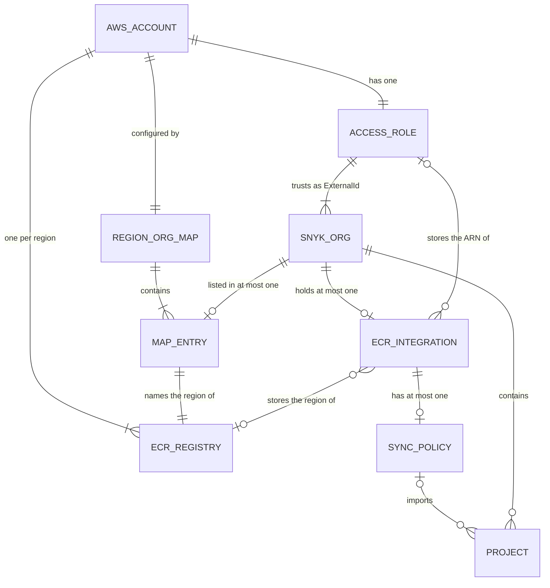

# Data Model: ECR → Snyk Onboarding (as-built baseline)

The tool stores nothing of its own. These are the objects it reads and writes in AWS and Snyk, as
the code sees them. The spec's [Key Entities](spec.md#key-entities) describe the same objects
without the field names; the spec's [lifecycle diagram](spec.md#overview) shows how one registry's
onboarding moves between states.

**Terms**: the spec's *ECR connection* is Snyk's *ECR integration*, the name the code, the plan, and
the tasks use. The spec's *read proof* is the *connection test*: an ImportAll dry run that imports
nothing.

## Relationships

The optional ends are deliberate: an integration whose credentials were deleted stores no role or
region, and a project outlives the policy that imported it (after a pause) or never had one (images
imported from the Snyk UI after a connect-only `apply`).

## Entities

### Region-to-org map (Terraform: `snyk_orgs` in `examples/main.tf`)

| Field | Type | Rule |
|-------|------|------|
| key | AWS region | `^[a-z]{2}(-[a-z]+)+-[0-9]$` |
| value | Snyk org ID | A UUID, checked by the module's `snyk_org_ids` validation |

The map MUST be non-empty, and no org ID may appear twice. Its values become the role's
`sts:ExternalId` list.

### Access role (Terraform module `snyk-ecr-role`)

| Field | Source | Rule or default |
|-------|--------|-----------------|
| `name` | `role_name` | Default `snyk-ecr-read` |
| trust principal | `snyk_aws_principal` | Required; `^arn:aws[a-z-]*:iam::[0-9]{12}:(root\|role/.+\|user/.+)$` |
| trust condition | `snyk_org_ids` | `StringEquals` on `sts:ExternalId`; a non-empty list of UUIDs |
| inline policy `snyk-ecr-read` | fixed | Eleven read-only ECR actions on `*` ([contracts/terraform-module.md](contracts/terraform-module.md)) |
| `permissions_boundary` | `permissions_boundary_arn` | Optional, default none |
| `max_session_duration` | `max_session_duration` | Default 3600 seconds |
| `tags` | `tags` | Default none |

### ECR integration (Snyk v1)

| Field | Rule |
|-------|------|
| `id` | Returned by Snyk; the v1 list maps `"ecr"` to it, so the tool sees at most one per org |
| `type` | Always `"ecr"` |
| `credentials.region` | `^[a-z]{2}(-[a-z]+)+-\d$` (`REGION_RE`) |
| `credentials.roleArn` | `^arn:aws[a-z-]*:iam::\d{12}:role/.+$` (`ROLE_ARN_RE`) |

The entry cannot be deleted through the API. Deleting its credentials leaves an empty entry that
`apply --update-credentials` can fill again.

### Sync policy (Snyk REST, `container_registry_import_policy`)

| Field | Rule |
|-------|------|
| `name` | Required by Snyk; default `ecr-onboarding` |
| `delete_images` | Boolean; default false |
| `schedule_frequency_hours` | Integer ≥ 2; omitted means Snyk's default, 24 |
| `import_policy.name` | Required by Snyk; filled from the type, or from `name` for a policy file |
| `import_policy.type` | One of the types below |
| `import_policy.policy` | The type's fields, below |
| `import_policy.sub_policies` | For `And` and `Or`: a list of import policies |

| Type | Fields (Snyk's names) | Selectable with |
|------|-----------------------|-----------------|
| `ImportAll` | none | `--import-policy` |
| `ImportAllNew` | none | `--import-policy` |
| `Regex` | `repo`, `tag` (RE2, at least one; no lookahead or lookbehind) | `--import-policy` |
| `Recent` | `maxAgeDays` (≥ 1) | `--import-policy` |
| `LastNObserved` | `limitNewestImages` (≥ 1) | `--import-policy` |
| `And`, `Or` | `sub_policies` | `--policy-file` only |
| `RuntimeIntegrations` | as Snyk documents it | `--policy-file` only |

A policy file holds this whole object as Snyk documents it: a `.json` file inside the working
directory, at most 64 KiB.

### Dry run job (Snyk REST)

| Field | Values |
|-------|--------|
| `id` | Returned when the job starts |
| `status` | `pending`, then `completed` or `failed` |
| `result.images_to_import` | A list of `{repository, tags: [{tag}]}` |
| `result.images_to_delete` | The same shape |
| `result.total_images_processed` | Integer |
| `error_message` | Set when `failed` |

The tool polls every `--poll-seconds` (3) until `completed` or `failed`, or until
`--dry-run-timeout` (300 s) passes.

### Project (Snyk REST)

| Field | Rule |
|-------|------|
| `id` | Used to delete it |
| `attributes.name` | `repository:tag`, sometimes prefixed with the registry host `\d{12}\.dkr\.ecr\.<region>\.amazonaws\.com(\.cn)?/`, which `repository_of` strips |
| `attributes.origin` | `ecr` for imported ECR images (undocumented, verified live) |

A repository name may contain dots (`my.app/service`); only an exact ECR host pattern counts as a
host, so a prefix match can never widen to other repositories.

## Input validation (before any network call)

| Input | Rule | Message on failure |
|-------|------|--------------------|
| `--org-id` | UUID | `--org-id must be a Snyk org UUID` |
| `--region` (plan, apply) | `REGION_RE` | `--region is required and must look like eu-west-3` |
| `--role-arn` (plan, apply) | `ROLE_ARN_RE` | `--role-arn is required and must be an IAM role ARN …` |
| `--api-base` | `https://` and host `snyk.io` or `*.snyk.io` | `--api-base must be an https://*.snyk.io URL …` |
| `--repo-prefix` | Required with `--delete-projects` | `--repo-prefix is required with --delete-projects …` |
| sync selection | See [contracts/cli.md](contracts/cli.md#sync-selection-rules) | |
