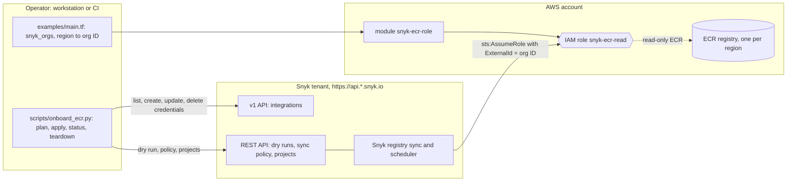
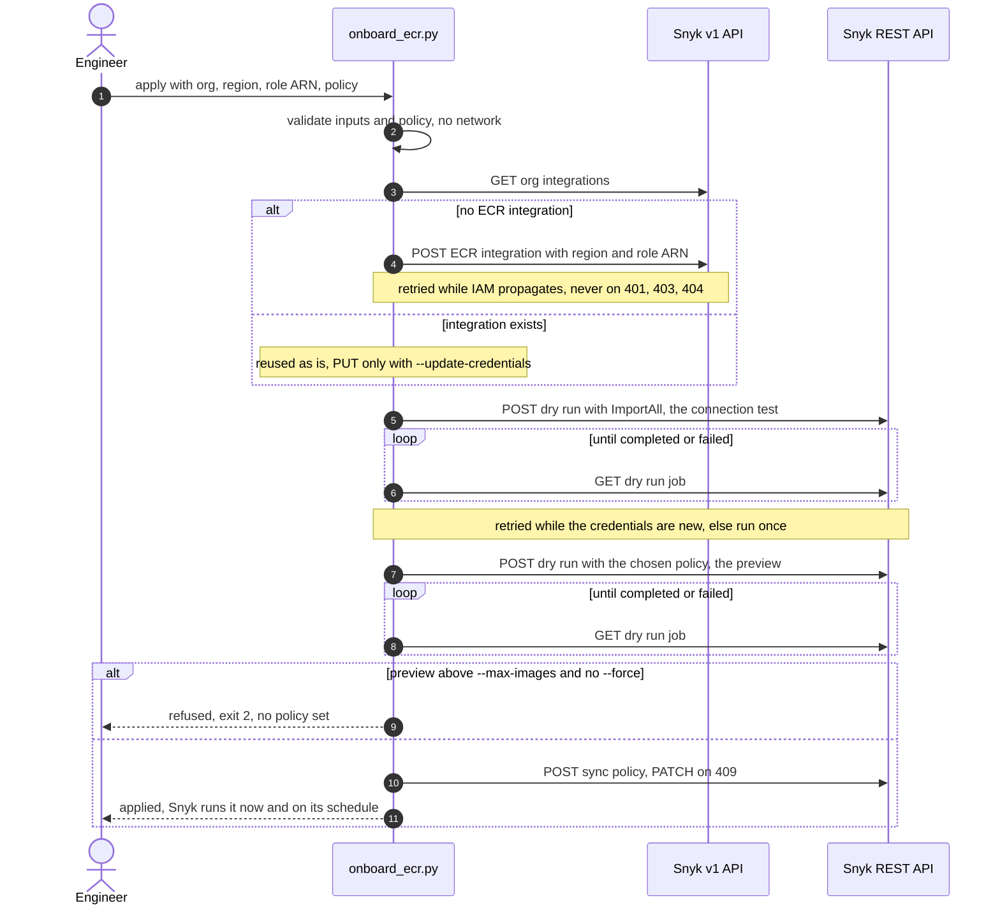
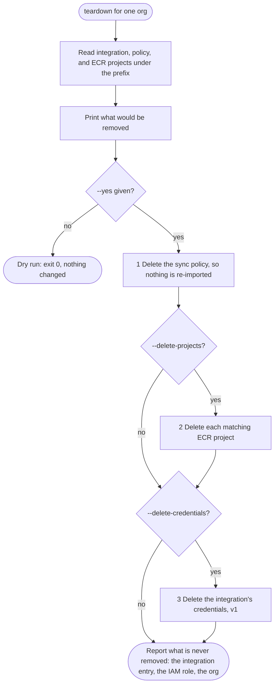
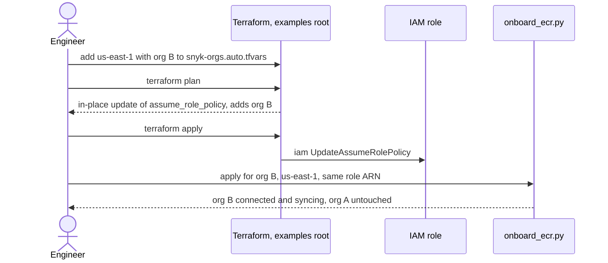

# Implementation Plan: ECR → Snyk Onboarding (as-built baseline)

**Branch**: `adopt-spec-kit` (feature `001-ecr-onboarding-baseline`) | **Date**: 2026-11-24 | **Spec**: [spec.md](spec.md)

**Input**: Feature specification from `specs/001-ecr-onboarding-baseline/spec.md`

**Note**: This is an as-built plan. It records how the delivered code at `f035a43` meets the spec and
proposes no new implementation. [tasks.md](tasks.md) records the delivered work by story and carries
the open items as tasks. The next behavior change starts the full cycle (`/speckit-specify` or an
amendment, then plan, tasks, implement, converge).

## Summary

The spec asks for one ECR registry to be connected to one Snyk org, with Snyk's own sync doing the
ongoing work and a bounded teardown. The delivered design splits this into two independent parts that
meet at one value, the role ARN:

- **AWS side, once per account**: a Terraform module (`terraform/modules/snyk-ecr-role`) creates one
  read-only IAM role whose trust policy lists every Snyk org ID of the account as an allowed
  `sts:ExternalId`. The example root (`examples/main.tf`) takes the account's region-to-org map.
- **Snyk side, once per registry**: a standard-library Python script (`scripts/onboard_ecr.py`) uses
  Snyk's v1 API for the ECR integration and Snyk's REST API for the connection test, the sync policy,
  and projects. Its four modes are `plan`, `apply`, `status`, and `teardown`.

## Technical Context

**Language/Version**: Python 3, standard library only; the minimum version is not declared
([research O3](research.md#open-items)), and the unit tests were re-run on 3.12. HCL for Terraform
1.5 or later (module); `make tf-test` needs Terraform 1.7 or later ([research O4](research.md#open-items)).

**Primary Dependencies**: none at runtime beyond the Python standard library, run with `uv`. The
`hashicorp/aws` provider 5.0 or later; the local, uncommitted lock files pin 6.67.0.

**Storage**: none of its own. The state lives in Snyk (integration, sync policy, projects), in AWS
(the role), and in the operator's Terraform state. Real `*.auto.tfvars` files live in the operator's
own repository.

**Testing**: `unittest` with `FakeClient`, a transport double that replays scripted responses and
records every call; `terraform test` with the AWS provider mocked (`examples/snyk_orgs.tftest.hcl`);
both run by `make check`. Live: `examples/sandbox/e2e.sh` with `harness.py` (throwaway orgs, ECR
repositories in two regions). See [quickstart.md](quickstart.md).

**Target Platform**: an operator workstation or a CI runner that can reach `*.snyk.io`; Terraform
runs wherever the organization runs it, including Terraform Enterprise.

**Project Type**: CLI tool plus a Terraform module.

**Performance Goals**: not applicable (a one-shot operator tool). Bounded waits instead: 60 s per HTTP
request; 5 retries of transient errors with backoff of 1, 2, 4, 8, and 16 s, or Snyk's `Retry-After`
capped at 60 s; 10 propagation attempts 15 s apart; dry runs polled every 3 s for at most 300 s.

**Constraints**: the v1 API is required for the integration (deprecated by Snyk, with no REST
equivalent); REST requests default to version `2025-09-17` (`--api-version`); one ECR integration per
Snyk org.

**Scale/Scope**: one registry per run. Snyk suggests direct registry scanning for estates of roughly
1,000 images or fewer, and caps what one sync run imports.

## Constitution Check

*GATE: Must pass before Phase 0 research. Re-check after Phase 1 design.* Checked against constitution
v1.0.0.

| Principle | Gate | Result | Evidence |
|-----------|------|--------|----------|
| I. Starting state never touched | Deletes limited to policy, credentials, prefixed projects; enforced by a test | Pass | `test_only_integration_scoped_deletes_ever_happen_never_the_org`; no org or registry call in `SnykClient` |
| II. Standard tooling | Terraform plus a standard-library script; no custom runtime | Pass | Script imports; `README.md` intro |
| III. Safe by default | Read-only counterparts, `--yes`, idempotent, no default policy, image limit | Pass | FR-010, FR-017, FR-022, FR-025 rows below |
| IV. Snyk's own terms | Snyk vocabulary, published specs, undocumented behavior marked and verified | Pass, one open item | Request version `2025-09-17` differs from the REST spec version the docs cite, `2026-03-25` ([research O1](research.md#open-items)) |
| V. Offline verification | `make check` green with no network or credentials | Pass | Re-run 2026-11-24 on `f035a43` |
| VI. Secrets stay out | Token from env only, Snyk hosts only, never printed; real values gitignored | Pass | FR-030 and FR-031 rows; `.gitignore` covers `*.auto.tfvars` |
| VII. Claim only what was verified | Verified, live, and unverified kept apart | Pass | `README.md` Status; [spec Verification Status](spec.md#verification-status) |
| VIII. Spec is the contract | Living spec with diagrams | Pass | This baseline establishes it |
| Product invariants | One registry per org; one role per account; least privilege; API split | Pass | FR-001, FR-005, FR-006, FR-009; [contracts/snyk-api.md](contracts/snyk-api.md) |

**Post-design re-check**: unchanged. No violation, so Complexity Tracking stays empty.

## Architecture

### Components



The role's trust policy allows `sts:AssumeRole` only from the tenant's Snyk principal and only with
`sts:ExternalId` equal to one of the listed org IDs; its inline policy grants eleven read-only ECR
actions on all resources ([contracts/terraform-module.md](contracts/terraform-module.md)).

### `apply`, step by step



`plan` follows the same path without the POST of the integration and the policy. When the
integration does not exist, it stops after the first GET and prints what `apply` would do.

### `teardown`



### Adding a region: where a change lands



The `terraform apply` step in this diagram is the one not yet verified live
([research O6](research.md#open-items)).

## Project Structure

### Documentation (this feature)

```text
specs/001-ecr-onboarding-baseline/
├── spec.md                  # What and why, with domain diagrams (/speckit-specify)
├── plan.md                  # This file: how, architecture, traceability (/speckit-plan)
├── research.md              # Decisions as built, undocumented Snyk behavior, open items
├── data-model.md            # Entities, relationships, validation rules
├── quickstart.md            # How to prove the tool works, offline and live
├── tasks.md                 # The delivered work by story, plus the open items (/speckit-tasks)
├── contracts/
│   ├── cli.md               # onboard_ecr.py: modes, flags, exit codes, output contract
│   ├── terraform-module.md  # Module and example root: inputs, outputs, resources
│   └── snyk-api.md          # Every Snyk API call the script makes, with permissions
└── checklists/
    └── requirements.md      # Spec quality checklist (/speckit-specify)
```

`tasks.md` came after this plan, so `/speckit-analyze` and `/speckit-converge` can check the baseline
as they would any feature.

### Source Code (repository root)

```text
scripts/onboard_ecr.py              # The Snyk side: one file, standard library only
terraform/modules/snyk-ecr-role/    # The AWS side: role, trust policy, inline read-only policy
examples/
├── main.tf                         # Example root: snyk_orgs map -> module call
├── snyk_orgs.tftest.hcl            # terraform test of the map's validations (AWS mocked)
├── snyk-orgs.auto.tfvars.example   # Template for the operator's own region-to-org file
└── sandbox/                        # Live e2e harness: e2e.sh, harness.py, fixture/, main.tf
tests/
├── test_onboard_ecr.py             # 74 unit tests of the script (FakeClient)
└── test_harness.py                 # 12 unit tests of the e2e harness's safety guards
docs/USAGE.md, docs/TESTING.md      # Operator guide and test guide
Makefile                            # test, tf-validate, tf-test, check, scan, aws-whoami
```

**Structure Decision**: unchanged from the delivered tool. The two sides stay in separate
directories because they run separately: Terraform once per account, the script once per registry.

## Requirement Traceability

Offline evidence names the unit tests (in `tests/test_onboard_ecr.py` unless stated) or `terraform
test` runs that assert the requirement. Live evidence refers to the e2e steps in
[docs/TESTING.md](../../docs/TESTING.md), US tenant: every scenario on 2026-10-19 (from the working
tree later committed as `f035a43`), and `e2e.sh single` on 2026-11-24 at `f035a43`.

| FR | Implemented in | Offline evidence | Live evidence |
|----|----------------|------------------|---------------|
| FR-001 | `parse_args`: one `--org-id`, one `--region` | None (structural) | The e2e drives one run per org |
| FR-002 | `SnykClient` has no org or registry calls | `test_only_integration_scoped_deletes_ever_happen_never_the_org` | `postcheck`: every org and both images untouched |
| FR-003 | `run_teardown` | `test_only_integration_scoped_deletes_ever_happen_never_the_org`, `test_only_matching_ecr_projects_are_deleted` | `down` |
| FR-004 | `ensure_integration`; deletes tolerate 404 | `test_apply_is_idempotent_reuses_integration`, `test_reports_credentials_already_removed_on_a_rerun`, `test_missing_policy_is_not_an_error` | Steps are re-run safely after failures |
| FR-005 | Module `data.aws_iam_policy_document.trust` | None: the mocked provider computes the documents | `new`: the role trusts exactly org a |
| FR-006 | Module `data.aws_iam_policy_document.ecr_read` | None | Snyk reads the registry; `make scan` reports no IaC issue on the module |
| FR-007 | Module and example: `snyk_aws_principal` has no default | `terraform validate` | Runs use the tenant's principal |
| FR-008 | `examples/main.tf` validations | `terraform test`: `one_region`, `second_region_shares_the_role`, `rejects_the_same_org_in_two_regions`, `rejects_keys_that_are_not_regions`, `rejects_an_empty_map` | — |
| FR-009 | One module call with `values(var.snyk_orgs)` | `second_region_shares_the_role` | `add-region` plan: only an in-place update. Apply: **not verified** |
| FR-010 | `run`, `ensure_integration(create=False)` | `test_plan_never_writes_when_integration_missing`, `test_plan_with_existing_integration_previews_but_never_writes`, `test_plan_with_no_sync_never_writes`, `test_plan_with_existing_integration_only_reads_and_dry_runs` | `new`: plan reports the integration missing |
| FR-011 | `ensure_integration` | `test_apply_creates_dry_runs_then_applies`, `test_apply_is_idempotent_reuses_integration`, `test_update_credentials_only_when_asked` | `new` |
| FR-012 | `connection_test` | `test_connection_test_runs_before_the_sync_preview`, `test_no_sync_connects_and_tests_but_sets_no_policy` | `new`: the test lists `snyk-e2e/app` |
| FR-013 | `ensure_integration`, `checked_dry_run` | `test_retries_integration_create_while_iam_propagates`, `test_does_not_retry_auth_failures`, `test_connection_test_retried_while_new_credentials_propagate`, `test_connection_test_on_reused_integration_is_not_retried_and_hints_update`, `test_update_credentials_counts_as_fresh`, `test_only_the_connection_test_is_retried_for_propagation` | A new role needed one retry in `ap-southeast-2` |
| FR-014 | `checked_dry_run` | `test_exhausted_retries_name_the_org_missing_from_the_external_id_list`, `test_connection_test_still_failing_after_retries_points_at_trust_policy`, `test_no_external_id_hint_when_the_first_attempt_succeeds_after_a_retry`, `test_reused_integration_failure_keeps_its_own_hint` | `add-region`: org n fails with the hint |
| FR-015 | `run` with `--no-sync` | `test_no_sync_connects_and_tests_but_sets_no_policy` | — |
| FR-016 | `ensure_integration` reads `list_integrations()["ecr"]` | None | The beta behavior was seen in a test org, November 2026 (`docs/USAGE.md`, Constraints 1) |
| FR-017 | `validate_sync_selection` | `test_there_is_no_default_sync` | — |
| FR-018 | `policy_from_flags`, `policy_from_file`, `validate_sync_selection` | `test_each_snyk_type_maps_to_its_documented_fields`, `test_regex_with_only_a_tag_sends_only_the_tag`, `test_policy_file_is_passed_through_as_written`, `test_policy_file_gets_only_the_names_snyk_requires`, `test_apply_with_a_policy_file_sends_it_unchanged`, `test_one_way_to_state_the_policy`, `test_fields_must_belong_to_the_chosen_snyk_type`, `test_each_type_needs_its_fields`, `test_no_sync_conflicts_with_any_sync_setting` | Regex policy in every e2e scenario |
| FR-019 | `policy_file_path` | `test_policy_file_must_be_a_json_file_inside_the_working_directory`, `test_policy_file_size_is_capped`, `test_policy_file_must_be_a_snyk_policy_object` | — |
| FR-020 | `check_policy` | `test_check_rejects_re2_unsupported_lookarounds_anywhere_in_the_tree`, `test_check_enforces_snyks_minimum_schedule`, `test_check_warns_when_rotating_types_lack_delete_images`, `test_check_flags_types_outside_snyks_documented_list`, `test_lists_types_of_nested_policies` | — |
| FR-021 | `checked_dry_run`, `summarise` | `test_apply_creates_dry_runs_then_applies`, `test_failed_dry_run_aborts_before_apply` | `new`: the preview selects exactly `v1.0.0` |
| FR-022 | `run`: the `--max-images` guard | `test_max_images_guard_blocks_apply` (exit 2), `test_force_overrides_guard` | — |
| FR-023 | `apply_policy` (POST, PATCH on 409); `policy_from_flags` | `test_policy_conflict_falls_back_to_patch`, `test_schedule_is_omitted_unless_given_so_snyk_applies_its_default` | An omitted schedule gave 24 hours (2026-10-01) |
| FR-024 | `run_status` | `test_status_is_read_only_and_needs_no_region_role_or_regex`, `test_all_origins_lists_every_project_with_its_origin`, `test_status_without_integration` | `status` |
| FR-025 | `run_teardown` | `test_dry_run_by_default_deletes_nothing`, `test_teardown_does_not_need_region_or_role` | `retire-region`: dry run, then `--yes` |
| FR-026 | `run_teardown`: delete order | `test_yes_deletes_policy_but_keeps_projects_unless_asked`, `test_credentials_deleted_after_policy_and_projects`, `test_credentials_removed_only_when_asked_and_confirmed` | `down`: every connection test fails afterwards |
| FR-027 | `repository_of`, `list_ecr_projects` | `test_delete_projects_requires_a_prefix`, `test_only_matching_ecr_projects_are_deleted`, `test_prefix_matches_project_names_that_include_the_registry_host`, `RepositoryNameTests` (4 tests) | Teardowns scoped to `snyk-e2e/` |
| FR-028 | `run_teardown`: final message | None | Printed in every e2e teardown |
| FR-029 | Deletes return False on 404 | `test_reports_credentials_already_removed_on_a_rerun`, `test_missing_policy_is_not_an_error`, `test_without_an_integration_only_projects_can_be_removed` | — |
| FR-030 | `main` | None | — |
| FR-031 | `validate_api_base`, `ApiError`, `SnykClient._follow` | `test_token_only_goes_to_snyk_https_hosts`, `test_token_never_logged_in_errors`, `test_network_errors_become_clean_errors_without_the_token`, `test_refuses_pagination_link_to_other_host` | — |
| FR-032 | `SnykClient.request`, `retry_after_seconds` | `test_backs_off_on_rate_limit`, `test_retry_after_is_case_insensitive_and_tolerates_dates`, `test_network_errors_become_clean_errors_without_the_token`, `test_non_json_success_body_is_a_clean_error` | — |
| FR-033 | `--api-base`, `SNYK_API_BASE` | `test_token_only_goes_to_snyk_https_hosts` accepts `https://api.eu.snyk.io` | US tenant only |
| FR-034 | `main`, `run` | Exit 0 in most workflow tests; exit 2 in `test_max_images_guard_blocks_apply`; exit 1: none | — |

## Complexity Tracking

> **Fill ONLY if Constitution Check has violations that must be justified**

No violations. The e2e harness needs `aws`, `docker`, and `jq`; it is test infrastructure, outside the
product that Principle II governs.
