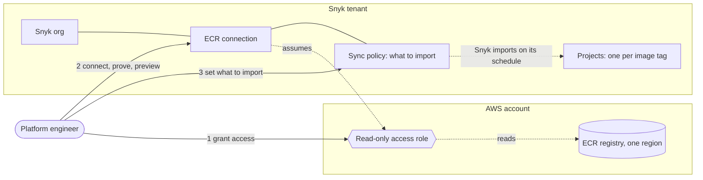
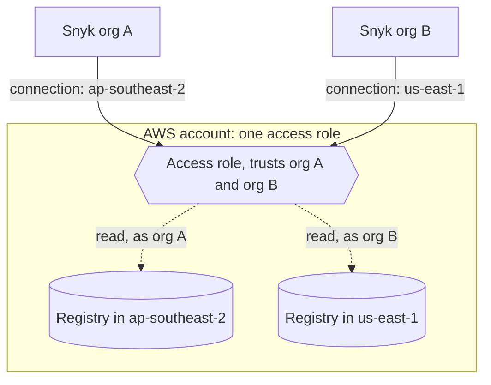
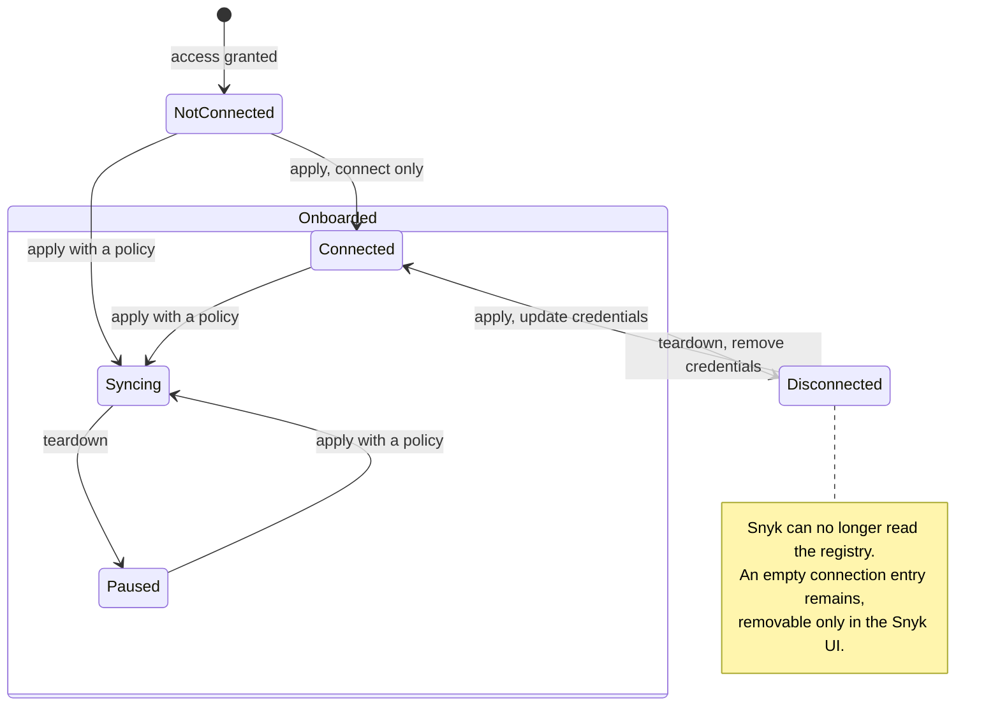

# Feature Specification: ECR → Snyk Onboarding (as-built baseline)

**Feature Branch**: `adopt-spec-kit`

**Created**: 2026-11-24

**Status**: Draft. Baseline of the delivered behavior at commit `f035a43`.

**Input**: User description: "Derive and elevate the specs of the existing tool so it is much easier
to describe and change: a baseline spec with diagrams, testable requirements, and a record of what
was assumed, so other engineers can decide how to reuse or extend the tool."

> **How to read this spec.** It states what the tool does and why, not how it is built. The how (the
> Terraform module, the script, the Snyk API calls) lives in [plan.md](plan.md) and
> [contracts/](contracts/). Each requirement below maps to its evidence in
> [plan.md, Requirement traceability](plan.md#requirement-traceability). To change the tool's
> behavior, amend this file first (Constitution, Principle VIII).

## Overview

The tool connects **one** Amazon ECR registry (one AWS account, one region) to **one** Snyk org so
Snyk can scan the registry's images, sets up Snyk's own automatic import of matching images, and
removes both again. The org and the registry exist before the tool runs and still exist after its
teardown.

After step 3 nothing of the tool keeps running. Snyk imports matching images on its own schedule and
retests the imported images; the engineer comes back only to change the policy, pause, or stop.

**Topology.** Snyk allows one ECR connection per org, so every registry (every region of every
account) has its own org. All orgs of one account share one access role, which trusts each of their
org IDs. Removing an org ID from that list cuts that org's access.

**Lifecycle of one registry's onboarding**, driven by the tool's four operations: `plan` (preview,
never writes), `apply`, `status` (read-only), and `teardown` (a dry run unless confirmed).

"Teardown" in the diagram means a confirmed teardown; unconfirmed, it changes nothing. In **Paused**
the connection and the imported projects stay and nothing new is imported. Applying another policy
while **Syncing** replaces the current one. From **Disconnected**, `apply` with updated credentials
and a policy goes straight back to **Syncing**.

## User Scenarios & Testing *(mandatory)*

### User Story 1 - Onboard one registry (Priority: P1)

An engineer has a Snyk org and an ECR registry in one AWS account and region. They grant Snyk
read-only access, preview the change, then apply it. The tool connects the org to the registry,
proves Snyk can read it, previews what the chosen sync policy would import, and sets the policy.
From then on Snyk imports matching images on its own schedule.

**Why this priority**: it is the tool's reason to exist, and every other story starts from a
connected registry.

**Independent Test**: in a sandbox account with one throwaway org and a repository holding the tags
`v1.0.0` and `latest`, grant access, then apply a policy matching only semantic-version tags. Within
10 minutes the org has a project for `v1.0.0` and none for `latest`.

**Acceptance Scenarios**:

1. **Given** an org with no ECR connection, **When** the engineer runs `plan`, **Then** nothing
   changes, and the tool reports that `apply` would create the connection and shows the policy it
   would set.
2. **Given** an org with no ECR connection, **When** the engineer runs `apply` with a policy,
   **Then** the tool creates the connection, reports the repositories and tags Snyk can see without
   importing anything, previews what the policy would import, and sets the policy.
3. **Given** access granted moments ago, **When** `apply` runs, **Then** the tool retries until Snyk
   can use the access (by default 10 attempts, 15 seconds apart) before it continues.
4. **Given** a preview that would import more than the image limit (1,000 by default), **When**
   `apply` runs without an override, **Then** no policy is set and the tool exits with the
   dedicated "refused" status.
5. **Given** no policy is stated, **When** `plan` or `apply` runs, **Then** the tool refuses and
   lists Snyk's policy types; the engineer may instead ask to connect only.
6. **Given** an org that is already connected, **When** `apply` runs again with a different policy,
   **Then** the connection is reused unchanged and the new policy replaces the old one.

---

### User Story 2 - Onboard more regions of the same account (Priority: P2)

An account already onboarded in one region gets a registry in a second region, or several regions
are onboarded together. Each region gets its own Snyk org, the account keeps one access role that
trusts every org, and the regions already onboarded keep working.

**Why this priority**: Snyk allows one ECR connection per org, and most estates span regions.

**Independent Test**: with org A connected in region A, add org B for region B to the account's
region-to-org mapping, update the access, and apply for org B. Org B syncs its region and org A still
passes its read proof.

**Acceptance Scenarios**:

1. **Given** org A in the account's mapping, **When** org B is added, **Then** the access change is
   only an in-place update of the role's trust list, and org A stays in that list.
2. **Given** org B not yet in the role's trust list, **When** `apply` runs for org B, **Then** it fails
   after its retries, and the message names org B as missing from the trust list and says how to
   recover.
3. **Given** a mapping that lists one org under two regions, uses a key that is not a region, or has
   no entries, **When** access is granted, **Then** the change is rejected before anything is changed.
4. **Given** several regions listed from the start, **When** access is granted once and `apply` runs
   once per region, **Then** each org connects to and syncs its own region.

---

### User Story 3 - Pause, retire a region, or remove everything (Priority: P2)

An engineer stops importing for a while, retires one region of several, or removes everything the
tool set up. Teardown shows what it would remove and acts only when confirmed.

**Why this priority**: a safe, bounded exit is what makes the tool acceptable against production
orgs.

**Independent Test**: on a connected org with a policy, an unconfirmed teardown with every option
changes nothing. The confirmed teardown removes the policy, then the projects under the prefix, then
the credentials. Afterwards Snyk can no longer read the registry, and the org still exists.

**Acceptance Scenarios**:

1. **Given** an org with a policy, **When** teardown runs unconfirmed, **Then** nothing changes and
   the tool lists exactly what it would remove.
2. **Given** an org with a policy, **When** teardown is confirmed with no options, **Then** only the
   policy is removed (a pause); the connection and the projects stay, and `apply` resumes the sync.
3. **Given** a request to remove projects with a repository prefix, **When** teardown is confirmed,
   **Then** only ECR projects whose repository name starts with that literal prefix are removed,
   whether or not their names include the registry host.
4. **Given** a request to remove the credentials, **When** teardown is confirmed, **Then** the policy
   goes first, the projects next, and the credentials last, and the tool states what it did not
   remove: the empty connection entry and the access role.
5. **Given** an account with several regions, **When** one region is retired, **Then** that org's ID
   leaves the trust list in place, and the role stays for the other regions.
6. **Given** a teardown that already completed, **When** it is confirmed again, **Then** it succeeds
   and reports the items as already removed.

---

### User Story 4 - Check status (Priority: P3)

An engineer checks what is set up for one org: the connection, the active policy, and the ECR
projects imported so far, without changing anything.

**Why this priority**: useful for support and audits, but nothing else depends on it.

**Independent Test**: running `status` against any org performs reads only.

**Acceptance Scenarios**:

1. **Given** any org, **When** `status` runs, **Then** the tool only reads, and reports the
   connection, the policy (name, types, schedule, whether stale images are removed), and the ECR
   projects.
2. **Given** doubt about how Snyk labels the projects, **When** `status` asks for every origin,
   **Then** every project in the org is listed with its origin.
3. **Given** an org with no connection, **When** `status` runs, **Then** it reports the connection as
   none and still lists the org's ECR projects.

---

### Edge Cases

- **The org already holds an ECR connection**: it is reused unchanged. Its stored role and region are
  replaced only when the engineer asks; `plan` only reports that it would.
- **The org is enrolled in Snyk's closed beta that allows several ECR connections per org**: see
  FR-016.
- **The read proof fails on a reused connection**: it is not retried, and the message suggests that
  the connection may have been disconnected and how to update its credentials.
- **The policy matches nothing, or imports only images pushed later (ImportAllNew)**: the preview can
  be empty; for ImportAllNew the tool explains why.
- **Recent or LastNObserved without removing stale images**: the tool warns that older projects then
  stay indefinitely.
- **A policy type outside Snyk's documented list**: the tool warns, and Snyk's preview decides.
- **Repository or tag patterns with lookahead or lookbehind**: rejected before anything is sent.
- **A schedule shorter than 2 hours**: rejected.
- **A policy document outside the working directory, not a `.json` file, or larger than 64 KiB**:
  rejected.
- **No token**: the tool refuses to start. **A rejected token or missing permission**: reported, not
  retried.
- **Rate limiting or a Snyk server error**: retried with backoff that follows Snyk's hint.
- **A network or TLS failure, or a success response that is not JSON**: a clear error that does not
  contain the token.
- **A paging link that points away from the Snyk API host**: refused.
- **Teardown on an org with no connection**: only projects can be removed.

## Requirements *(mandatory)*

### Functional Requirements

**Scope and safety**

- **FR-001**: The tool MUST act on exactly one registry (one AWS account, one region) and one Snyk org
  per run, both chosen by the engineer; it MUST NOT iterate over accounts, regions, or orgs.
- **FR-002**: The tool MUST NOT create or delete a Snyk org, an ECR registry, a repository, or an
  image.
- **FR-003**: Every deletion MUST be one of: the org's sync policy; the credentials stored in the
  org's ECR connection; ECR projects under an engineer-supplied literal repository prefix.
- **FR-004**: Every operation MUST be safe to re-run with the same inputs and MUST converge on the same
  end state.

**Access**

- **FR-005**: Access MUST be one role per AWS account that only the tenant's Snyk principal can
  assume, and only when it presents one of the account's listed org IDs as the external ID.
- **FR-006**: The role MUST grant only the read-only registry actions Snyk documents for ECR access;
  it MUST NOT allow pushing, deleting, or modifying anything.
- **FR-007**: The Snyk principal MUST be a required input with no built-in value.
- **FR-008**: The account's region-to-org mapping MUST have at least one entry, use AWS region names
  as keys, and never list an org under two regions; a violation MUST be rejected before any change.
- **FR-009**: Adding or removing a region MUST change only the role's trust list, in place, keeping
  the role and the other orgs' access.

**Connection**

- **FR-010**: `plan` MUST NOT change anything. Without a connection, it MUST report that `apply`
  would create one and show the policy `apply` would set; with a connection, it MUST run the read
  proof and the sync preview.
- **FR-011**: `apply` MUST create the org's ECR connection when it is missing, and reuse an existing
  one unchanged, replacing its stored role and region only when the engineer asks.
- **FR-012**: After connecting, `apply` MUST prove that Snyk can read the registry, import nothing
  while doing so, and report the repositories and tags Snyk sees. The sync preview MUST NOT start
  before this proof passes.
- **FR-013**: When credentials were set in the same run, creating the connection and the read proof
  MUST be retried (by default 10 attempts, 15 seconds apart) to absorb access propagation. A rejected
  token or missing permission MUST NOT be retried, and on a connection reused unchanged the read proof
  MUST run once.
- **FR-014**: When the read proof still fails after its retries, the tool MUST list the likely causes
  (naming the org ID that may be missing from the role's trust list, a wrong Snyk principal, a wrong
  region, a disabled STS region) and the recovery: `apply` again, asking to update the credentials.
- **FR-015**: `apply` MUST support connect-only: the connection and the read proof, with no sync
  policy.
- **FR-016**: When the org holds more than one ECR connection (Snyk's closed multi-connection beta),
  the tool MUST [NEEDS CLARIFICATION: refuse to run against that org, or keep today's behavior of
  acting on the one connection Snyk's listing names, with the documented warning not to run it
  there?]

**Sync policy**

- **FR-017**: There MUST be no default policy. Without a policy or connect-only, `plan` and `apply`
  MUST refuse and list Snyk's policy types.
- **FR-018**: The policy MUST be stated in Snyk's own terms: one of ImportAll, ImportAllNew, Regex,
  Recent, or LastNObserved with only that type's fields, or a policy document in Snyk's format, sent
  unchanged except for names filled in when missing. Stating both, fields that do not belong to the
  type, missing required fields, or sync settings combined with connect-only MUST be rejected before
  anything is sent.
- **FR-019**: A policy document MUST be a `.json` file inside the current working directory and no
  larger than 64 KiB.
- **FR-020**: The tool MUST reject, anywhere in a policy, repository or tag patterns that use
  lookahead or lookbehind (Snyk's pattern engine supports neither) and a schedule shorter than 2
  hours. It MUST warn, without refusing, when Recent or LastNObserved run without removing stale
  images, and when a type is outside Snyk's documented list.
- **FR-021**: Before setting a policy, `apply` MUST preview it and report the images processed, to
  import, and to delete, with sample repositories. A failed preview MUST stop `apply` with no policy
  set.
- **FR-022**: `apply` MUST refuse to set a policy whose preview imports more than the image limit
  (default 1,000) unless the engineer overrides it, and MUST exit with the dedicated "refused" status.
- **FR-023**: Setting a policy MUST replace the org's current policy. An omitted schedule MUST be left
  to Snyk's default (24 hours).

**Status**

- **FR-024**: `status` MUST only read, and MUST report the connection, the policy (name, types,
  schedule, whether stale images are removed), and the org's ECR projects; on request, every project
  in the org with its origin.

**Teardown**

- **FR-025**: `teardown` MUST be a dry run that lists exactly what it would remove unless confirmed,
  and MUST NOT need the region or the role.
- **FR-026**: A confirmed teardown MUST remove the sync policy first, then the requested projects,
  then, when asked, the stored credentials. Without options it removes only the policy (a pause).
- **FR-027**: Removing projects MUST require a literal repository prefix, and MUST match only ECR
  projects, whether or not their names include the registry host.
- **FR-028**: `teardown` MUST report what it does not remove: the empty connection entry (removable
  only in the Snyk UI) and the access role.
- **FR-029**: A repeated confirmed teardown MUST succeed and report items already removed; on an org
  without a connection, only projects can be removed.

**Credentials and transport**

- **FR-030**: The Snyk token MUST be read only from the environment; without it, the tool MUST refuse
  to start.
- **FR-031**: The token MUST be sent only to Snyk API hosts over HTTPS and MUST NOT appear in output or
  errors; paging links that lead away from that host MUST be refused.
- **FR-032**: Transient Snyk failures (rate limiting, server errors) MUST be retried with backoff that
  honors Snyk's retry hint, waiting at most 60 seconds each time. Network failures and success
  responses that are not JSON MUST end in a clear error.
- **FR-033**: The tool MUST support Snyk's non-US tenants through a configurable API host.
- **FR-034**: The tool MUST exit with 0 on success, 1 on an error, and 2 when `apply` is refused by
  the image limit.

### Key Entities

- **AWS account**: owns the registries and exactly one access role for Snyk.
- **ECR registry**: one per account and region; holds repositories of tagged images. A prerequisite,
  never changed by the tool.
- **Access role**: one per account. Trusts the tenant's Snyk principal, only with one of the listed
  org IDs as the external ID, and grants read-only registry actions.
- **Region-to-org mapping**: one per account; one entry per onboarded registry. It is the single
  source of the role's trust list.
- **Snyk tenant**: has an API host (US by default, or EU or AU) and a Snyk principal shown in its UI.
- **Snyk org**: holds at most one ECR connection. A prerequisite, never created or deleted by the
  tool.
- **ECR connection**: an org's link to one registry, storing the role and the region. Its entry cannot
  be deleted through Snyk's API, only emptied of credentials.
- **Sync policy**: at most one per connection. A tree of Snyk policy types, a schedule, whether stale
  images are removed, and a name.
- **Project**: one per imported image tag, named `repository:tag`, with the origin `ecr`.

## Success Criteria *(mandatory)*

### Measurable Outcomes

- **SC-001**: An engineer with the prerequisites in place onboards a registry with one access change
  and one `apply`, and in every run sees proof that Snyk can read the registry, and a preview of what
  will be imported, before anything is imported.
- **SC-002**: Previews, status checks, and unconfirmed teardowns make zero changes in Snyk or AWS.
- **SC-003**: A teardown with every option deletes nothing outside the three permitted kinds of items,
  with zero exceptions.
- **SC-004**: Matching images appear as projects within 10 minutes of `apply`, and non-matching tags
  never do.
- **SC-005**: After access is granted, a new connection either works or fails with named causes within
  about 2.5 minutes at default settings.
- **SC-006**: Adding a region interrupts no existing region: each existing org still passes its read
  proof afterwards.
- **SC-007**: After any failure, re-running the same operation reaches the intended state. The only
  manual step the tool leaves is the optional removal of the empty connection entry in the Snyk UI.
- **SC-008**: The full offline check completes in under one minute with no network access and no
  credentials.

## Assumptions

- **Users** are platform or security engineers who work with infrastructure as code and a terminal,
  and hold admin rights on the Snyk org.
- **Prerequisites are out of scope and exist beforehand**: a Snyk org with Snyk Container, an ECR
  registry, AWS rights to create an IAM role and update its trust policy, and the `us-east-2` region
  enabled for STS (Snyk's requirement).
- **Tokens**: a Snyk service-account access token (recommended) or a personal access token (testing
  only). OAuth 2.0 service accounts, which use bearer tokens, are not supported; this is a known gap
  and the likely next feature.
- **Snyk does the ongoing work**: it runs the sync at least 2 hours apart (24 by default), retests
  imported images, caps how many images one run imports, and skips images over 2 GB.
- **One ECR connection per org** is a Snyk constraint the whole design depends on.
- **Policies are allow-lists**: they choose what to include, and there is no exclude.
- **Out of scope**: creating or deleting orgs and registries; iterating over accounts or regions;
  deleting the empty connection entry; restricting read access to specific repositories (possible by
  editing the role's permissions, but not a supported option).
- **Snyk behavior that Snyk does not document** is relied on only where it was verified live; the list
  is in [research.md](research.md#snyk-behavior-relied-on-but-not-documented).

## Verification Status

Per Constitution Principle VII. Details per requirement are in
[plan.md, Requirement traceability](plan.md#requirement-traceability).

| Level | Requirements | Evidence |
|-------|--------------|----------|
| Offline tests | Every requirement not listed in the rows below | `make check` at `f035a43`, re-run 2026-11-24: 86 unit tests, 5 `terraform test` runs, `fmt` and `validate` pass (Python 3.12, Terraform 1.17.2) |
| Live only, no offline test | FR-005, FR-006, FR-007 (the role, its trust, its permissions, the principal input); FR-028 (the "not removed" report) | From-scratch end-to-end runs on the US tenant, last on 2026-10-19 ([docs/TESTING.md](../../docs/TESTING.md)) |
| Live, partly | FR-009: the in-place plan was verified; applying it was not | The test identity lacked `iam:UpdateAssumeRolePolicy` |
| Not verified live | FR-033 on the EU and AU tenants | Only the US tenant was tested |
| Code review only | FR-001; FR-030 (missing token); FR-034's exit code 1 | No test exercises these paths |
| No defined behavior | FR-016 | Clarification pending |

Live coverage by story, on the US tenant with a personal token and with an org service account:
Stories 1 and 4 in full; Story 2 except applying the trust update; Story 3 except retiring one region
of several, which needs that same update.
