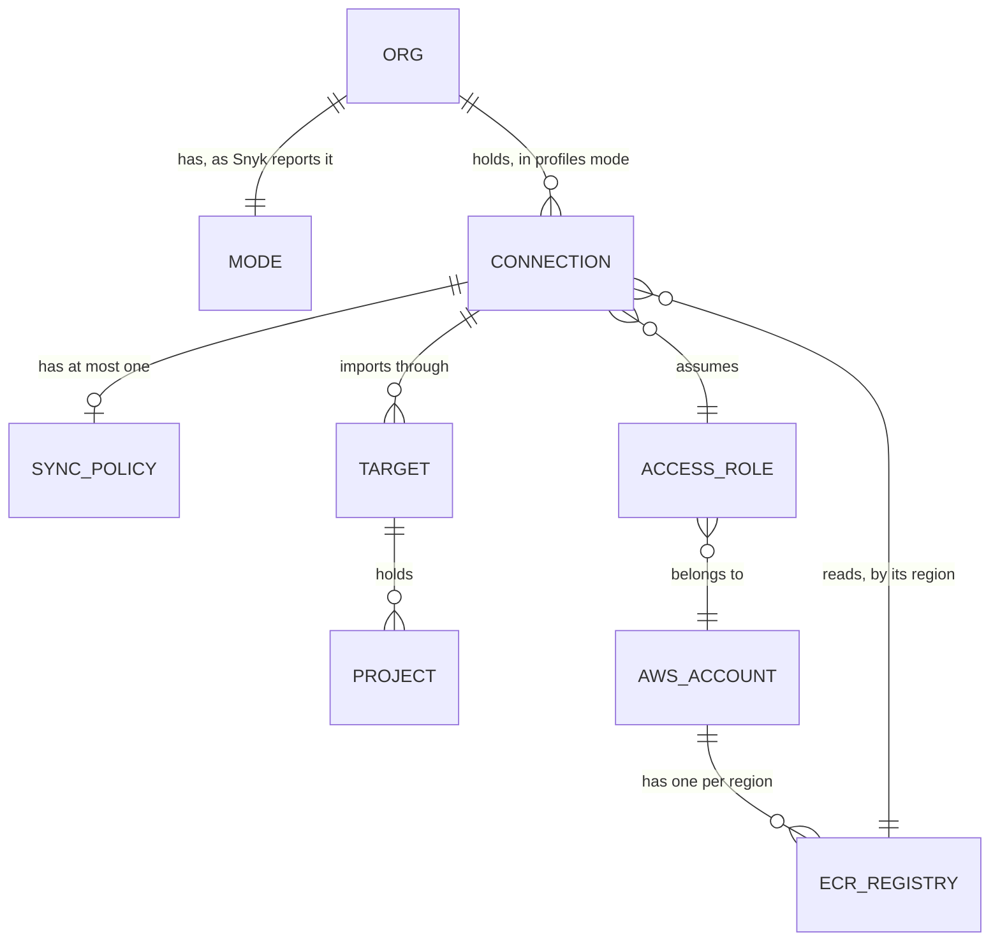
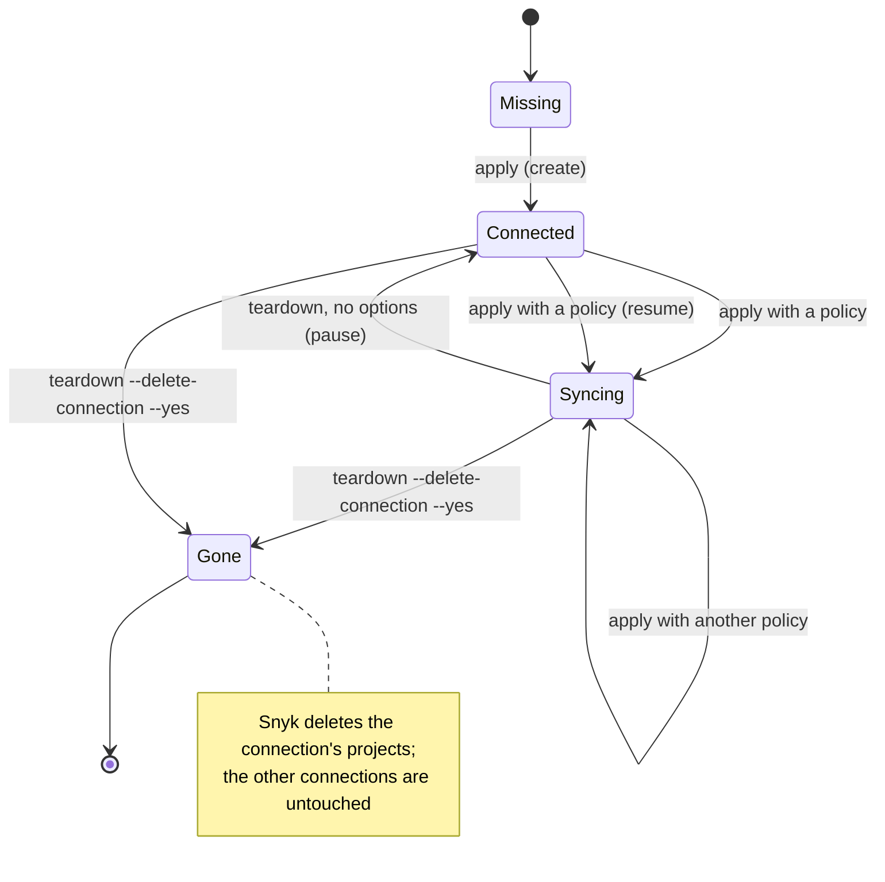

# Data Model: Several ECR connections in one Snyk org

What changes from the baseline's [data model](../001-ecr-onboarding-baseline/data-model.md) for orgs in
profiles mode. In default mode every entity there applies unchanged. The tool still stores nothing of
its own: everything below lives in Snyk or in the operator's Terraform inputs.

**Terms**: the spec's *named connection* is Snyk's *profile*, an ECR integration with a
`profile_name`. Calls are numbered as in [contracts/snyk-api.md](contracts/snyk-api.md).

## Relationships

A connection reads exactly one registry: the one in the account of its role, in its region. Two
connections may read the same registry only under explicit, different names.

## Entities

### Mode (per org, from call 13)

| Value | Signal | Effect |
|-------|--------|--------|
| `profiles` | `200` | Connections through calls 13 to 17; v1 calls 1 to 4 are never made |
| `default` | `404` with error detail `Endpoint Not Found` | The baseline, unchanged |
| none | any other answer | The run stops with exit 1 before any change |

Taken on every run, never cached, never chosen by the engineer.

### Connection (Snyk: profile; calls 13 and 14)

| Field | Source | Notes |
|-------|--------|-------|
| `id` | `data[].id` (call 13) | The integration ID; also the `{id}` of the sync calls 5 to 10 |
| `integration_type` | `attributes.integration_type` | Only `ecr` entries are connections; the list holds every integration type |
| `name` | `attributes.profile_name` | Unique in the org (Snyk's index on org, type, and name); at most 255 characters |
| `region` | `credentials.region` (call 14) | An AWS region name |
| `role_arn` | `credentials.role_arn` (call 14) | v1 spells it `roleArn` |
| `account` | Derived: the account in `role_arn` | The registry is in the role's account (spec Assumptions) |
| `registry_uri` | Derived: `<account>.dkr.ecr.<region>.amazonaws.com`, with `.amazonaws.com.cn` for `cn-` regions | The default name |

A connection made through v1 before the flag was enabled has no stored name; the hidden list is
expected to show it as `Default profile` ([research](research.md), R6, live check L2).

**Lookup** (R3), before any write:

| Given | None match | One matches | Several match |
|-------|------------|-------------|---------------|
| `--connection NAME` | `plan`: report it would be created. `apply`: create it. `status`, `teardown`: change nothing, list the connections, exit 1 | Use it; refuse when its account or region differs from the run's, unless `--update-credentials` | Not possible: names are unique |
| No name (`plan`, `apply`) | Create it, named `registry_uri` | Use it, whatever its name | Change nothing, list them, exit 1 |
| No name (`teardown`) | Change nothing, list the connections, exit 1 | Same | Same |

### Target (Snyk REST; call 18)

| Field | Source | Notes |
|-------|--------|-------|
| `id` | `data[].id` | |
| `display_name` | `attributes.display_name` | The repository, for example `team-a/app` |
| `integration_id` | `relationships.integration.data.id` | The connection that imported it; the only source of provenance |
| `integration_type` | `attributes.integration_type` | `ecr` for the targets that matter here |

### Project (Snyk REST; call 11, extended)

| Field | Source | Notes |
|-------|--------|-------|
| `id`, `name`, `origin` | As in the baseline | Names stay `repository:tag`; the same name can belong to several connections |
| `target_id` | `relationships.target.data.id` | Joins the project to its target |
| `connection` | Derived: the target's `integration_id`, then that connection's name | "Connection unknown" when the target names no connection or names one that is not listed |

### Sync policy

Unchanged from the baseline, one per connection, addressed by the connection's `id`.

### Account access (Terraform, example root)

| Input | Meaning | Validation |
|-------|---------|------------|
| `snyk_orgs` | Region → org ID, for default-mode orgs and the script's `--region`/`--org-id` pairs | As the baseline, except that it may be empty when `snyk_profile_orgs` is not |
| `snyk_profile_orgs` (new) | Org IDs that read the account's ECRs in any region | UUIDs; no duplicates |
| Trusted set | The distinct union of `values(snyk_orgs)` and `snyk_profile_orgs` | At least one org; passed to the module as `snyk_org_ids` |

## Validation and refusal rules (before any write)

| Rule | Requirement |
|------|-------------|
| `--connection` or `--delete-connection` on a default-mode org: refused | FR-003 |
| `--delete-credentials` on a profiles-mode org: refused, pointing to `--delete-connection` or a pause | R9 |
| `teardown` without a connection, or naming one that does not exist: nothing changes, the connections are listed, exit 1 | FR-005, edge cases |
| `apply` naming a connection whose account or region differs from the run's: refused without `--update-credentials` | FR-006 |
| A run without a name for an ECR that two connections read: nothing changes, both are listed, exit 1 | FR-005 |
| `teardown --delete-projects` while any of the connection's candidate projects has an unknown connection: refused | FR-011, FR-013 |
| Every delete is one of: the named connection's policy; the named connection itself; projects whose target names that connection, optionally narrowed by a literal repository prefix | Constitution I |

## State of one connection

