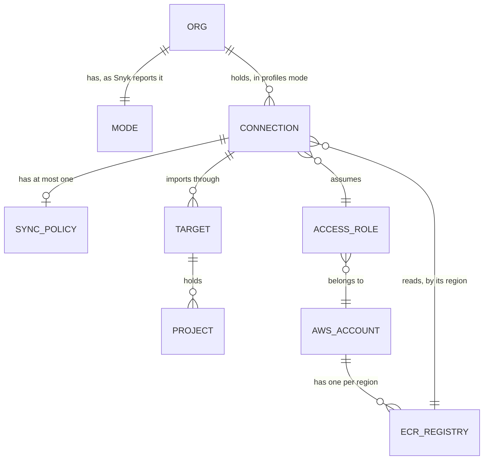
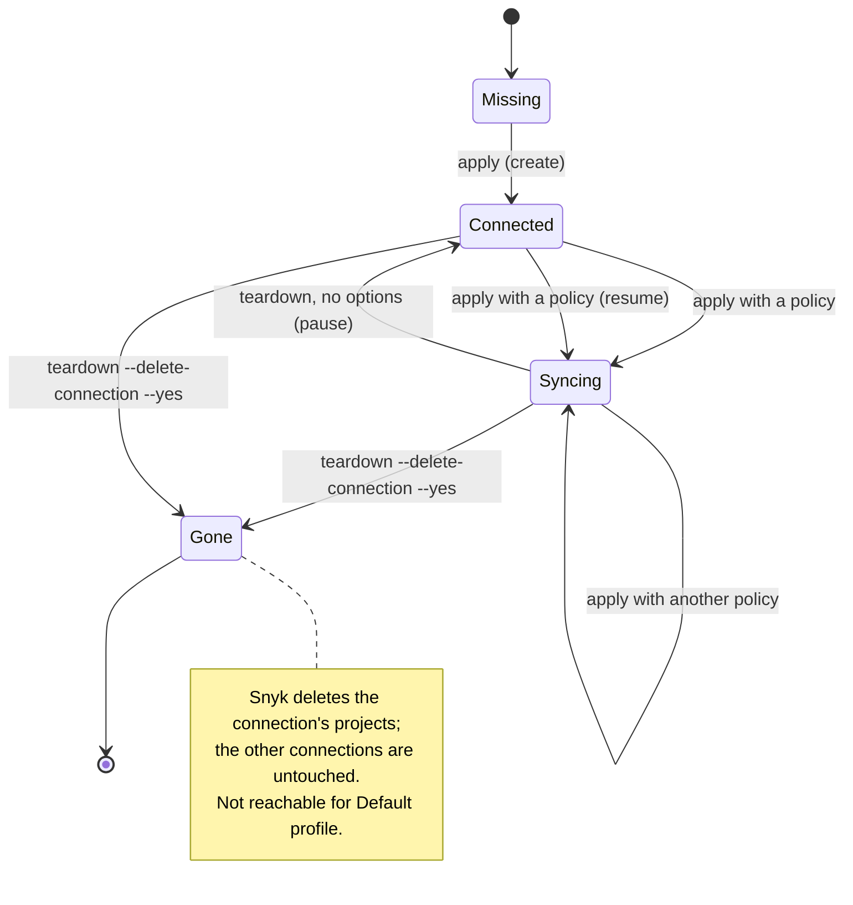

# Data Model: Several ECR connections in one Snyk org

What changes from the baseline's [data model](../001-ecr-onboarding-baseline/data-model.md) for orgs in
profiles mode. In default mode every entity there applies unchanged. The tool still stores nothing of
its own: everything below lives in Snyk or in the operator's Terraform inputs.

**Terms**: the spec's *named connection* is Snyk's *profile*, an ECR integration with a
`profile_name`. Calls are numbered as in [contracts/snyk-api.md](contracts/snyk-api.md).

## Relationships



A connection reads exactly one registry: the one in the account of its role, in its region. Snyk's API
does not return the role or the region, so the tool knows which registry only from the connection's
name ([research R3](research.md#r3-finding-a-connection-fr-004-fr-005-fr-006)). Two connections may read
the same registry only under explicit, different names.

## Entities

### Mode (per org, from call 13)

| Value | Signal | Effect |
|-------|--------|--------|
| `profiles` | `200` | Connections through calls 13 to 16; v1 calls 1 to 4 are never made |
| `default` | `406`, matched as live check L6 records it | The baseline, unchanged |
| none | any other answer | The run stops with exit 1 before any change |

Taken on every run, never cached across runs, never chosen by the engineer.

### Connection (Snyk: profile; call 13)

| Field | Source | Notes |
|-------|--------|-------|
| `id` | `data[].id` | The integration ID; also the `{id}` of the sync calls 5 to 10 |
| `integration_type` | `attributes.integration_type` | Only `ecr` entries are connections; the list holds every integration type |
| `name` | `attributes.profile_name` | Unique in the org; 1 to 255 characters; `null` is read as `Default profile` |
| `label` | Parsed from `name` | The part before the registry address, if any |
| `account`, `region` | Parsed from `name` | Unknown when the name carries no registry address |
| `registry_address` | Parsed from `name`: `<account>.dkr.ecr.<region>.amazonaws.com` | Unknown when the name carries none |
| `api_deletable` | Derived: false when `name` is `Default profile` | A connection made before the flag; Snyk lets the API delete only connections created as profiles |

#### Names

```text
name    = [ label " " ] address           (made by the tool by default)
        | any other name Snyk accepts     (exact: --exact-name, Snyk's UI, or "Default profile")
address = <12 digits> ".dkr.ecr." <region> ".amazonaws.com"
label   = a letter or digit, then letters, digits, "_", "-", or "."
```

A name "carries an ECR" when it matches the first form. Snyk's own rule allows spaces anywhere, so an
exact name may contain them; a label may not, which keeps the parse unambiguous.

A connection made through v1 before the flag was enabled is listed as `Default profile`, keeps its v1
ID, can be renamed and repointed, and cannot be deleted through the API
([research R6](research.md#r6-a-connection-made-before-the-flag-question-10)).

**Lookup** (R3), before any write. "Carries" means its name carries that ECR; "unknown" means its
name carries none.

| Given | Result |
|-------|--------|
| `--connection VALUE`, a connection named exactly VALUE | Use it. Carries the run's ECR: reused unchanged. Carries another: refused unless `--update-credentials`. Unknown: used, with a warning that its ECR cannot be checked |
| `--connection VALUE`, no exact name, connections labeled VALUE | One: as above. Several: change nothing, list them, exit 1 |
| `--connection VALUE`, nothing matches | `plan`: report it would be created. `apply`: create `VALUE <address>`, or `VALUE` when it already carries the run's address, or `VALUE` exactly with `--exact-name`. `status`, `teardown`: change nothing, list the connections, exit 1 |
| No name (`plan`, `apply`), connections carrying the run's ECR | One: use it. Several: change nothing, list them, exit 1 |
| No name (`plan`, `apply`), none carries it | No unknown connection: create `<address>`. An unknown connection exists: change nothing, list the connections, ask for a name, exit 1 |
| No name (`teardown`) | Change nothing, list the connections, exit 1 |

### Target (Snyk REST; call 17)

| Field | Source | Notes |
|-------|--------|-------|
| `id` | `data[].id` | |
| `display_name` | `attributes.display_name` | The repository, for example `team-a/app` |
| `integration_id` | `relationships.integration.data.id` | The connection that imported it; the only source of provenance |
| `integration_type` | `attributes.integration_type` | `ecr` for the targets that matter here |

### Project (Snyk REST; call 11, extended)

| Field | Source | Notes |
|-------|--------|-------|
| `id`, `name`, `origin` | As in the baseline | Names stay `repository:tag`; the same name can belong to several connections |
| `target_id` | `relationships.target.data.id` | Joins the project to its target |
| `connection` | Derived: the target's `integration_id`, then that connection's name | "Connection unknown" when the target names no connection or names one that is not listed |

### Sync policy

Unchanged from the baseline, one per connection, addressed by the connection's `id`.

### Account access (Terraform, example root)

| Input | Meaning | Validation |
|-------|---------|------------|
| `snyk_orgs` | Region → org ID, for default-mode orgs and the script's `--region`/`--org-id` pairs | As the baseline, except that it may be empty when `snyk_profile_orgs` is not |
| `snyk_profile_orgs` (new) | Org IDs that read the account's ECRs in any region | UUIDs; no duplicates |
| Trusted set | The distinct union of `values(snyk_orgs)` and `snyk_profile_orgs` | At least one org; passed to the module as `snyk_org_ids` |

## Validation and refusal rules (before any write)

| Rule | Requirement |
|------|-------------|
| `--connection`, `--exact-name`, or `--delete-connection` on a default-mode org: refused | FR-003 |
| `--exact-name` without `--connection`, or with `Default profile`: refused | R9 |
| A label outside the label rule, or a name over 255 characters or outside Snyk's rule: refused | Spec Assumptions (names) |
| A `--connection` value carrying another registry address than the run's `--role-arn` and `--region`: refused | R3 |
| A role ARN or region outside AWS's standard partition: refused, naming the limitation | R13 |
| `--delete-credentials` on a profiles-mode org: refused, pointing to `--delete-connection` or a pause | R9 |
| `teardown` without a connection, or naming one that does not exist: nothing changes, the connections are listed, exit 1 | FR-005, edge cases |
| `apply` naming a connection whose name carries another account or region than the run's: refused without `--update-credentials` | FR-006 |
| `--update-credentials` whose rename would take a name in use (`409`): refused, nothing changed | R4 |
| A run without a name where two connections carry the ECR, or where none does and an unknown one exists: nothing changes, the connections are listed, exit 1 | FR-005 |
| `teardown --delete-connection` on `Default profile`: refused, pointing to Snyk's UI and suggesting a rename to its registry address | FR-014, R6 |
| `teardown --delete-projects` while any of the connection's candidate projects has an unknown connection: refused | FR-011, FR-013 |
| Every delete is one of: the named connection's policy; the named connection itself; projects whose target names that connection, optionally narrowed by a literal repository prefix | Constitution I |

## State of one connection


