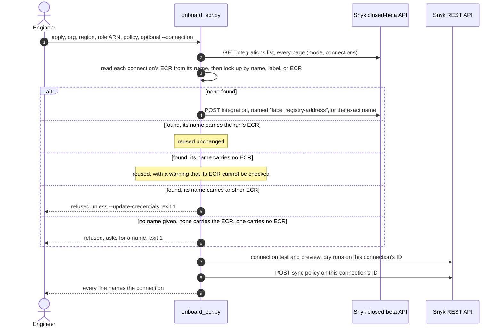
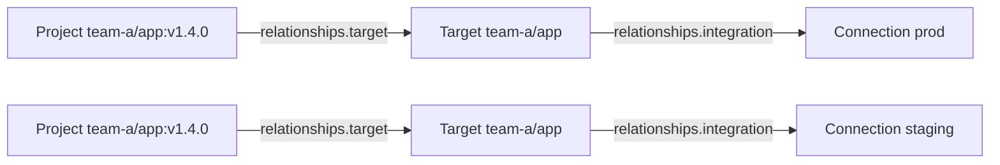
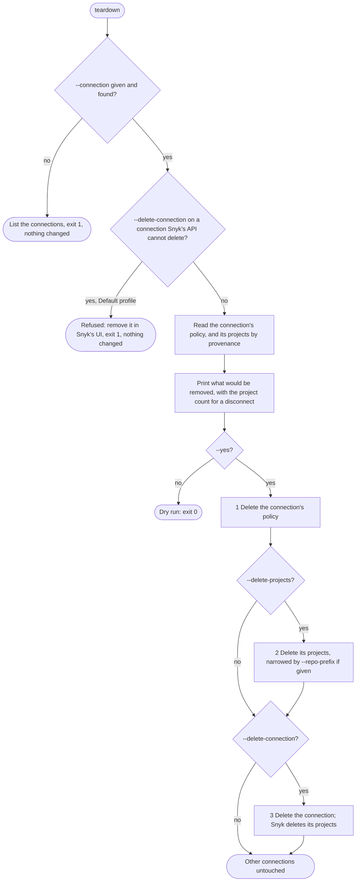

# Implementation Plan: Several ECR registries in one Snyk org

**Branch**: `002-multi-ecr-connections` | **Date**: 2026-11-24 | **Spec**: [spec.md](spec.md)

**Input**: Feature specification from `specs/002-multi-ecr-connections/spec.md`, clarified in three
rounds on 2026-11-24.

## Summary

Orgs where Snyk has turned on its multiple profiles feature hold any number of ECR connections, and
the tool must manage them one at a time without touching the others. The tool asks Snyk for the
org's mode on every run. In default mode it behaves exactly as baseline 001. In profiles mode it lists
the org's connections through Snyk's closed-beta Integrations API, reads each one's ECR from its name,
finds the named connection or the one whose name carries the run's ECR, and reuses the baseline's
sync, preview, and policy calls with that connection's ID. Where an image came from is read from
Snyk's own record (project → target → connection), never from repository names. On the AWS side the
module already trusts orgs without regard to regions; the example root gains one optional input so an
account read only by profiles-mode orgs needs no region keys.

## Owner decisions (2026-11-24)

1. **The one exception to the constitution is approved** (Principle IV), with its conditions. It was
   approved for Snyk's undocumented `hidden` tier; the profiles calls now use the `closed-beta` tier,
   which Snyk documents for beta customers, so the exception is narrower
   ([research R2](research.md#r2-snyks-closed-beta-integrations-api-question-9-principle-iv),
   [Complexity Tracking](#complexity-tracking)). Open action: ask the beta team whether and when the
   API will be promoted.
2. **The Terraform input is `snyk_profile_orgs`**, beside the region-to-org map
   ([research R8](research.md#r8-account-access-without-regions-fr-016-fr-017-question-7)).
3. **The live test runs on `antonio-org` for now**, under the harness's guards, and moves to a
   throwaway org if the beta team enables one. The owner kept it after the feature's one-pager advised
   a test org, accepting that risk
   ([research R10](research.md#r10-where-the-profile-mode-live-test-runs)).
4. **Names carry their ECR** by default, `[<label> ]<registry address>`, with an exact name on request;
   for a connection whose name carries none, `status` points to Snyk's UI (third clarification round;
   [research R3](research.md#r3-finding-a-connection-fr-004-fr-005-fr-006)).

## Technical Context

**Language/Version**: Python 3, standard library only, as the baseline; HCL for Terraform 1.5 or later
(module) and the example root, whose minimum this feature does not raise.

**Primary Dependencies**: none new. Snyk's v1 API (default mode only), its REST API (both modes), and
its `closed-beta` Integrations API at version `2024-10-15` (the mode check in both modes; connections
in profiles mode).

**Storage**: none of its own; see [data-model.md](data-model.md).

**Testing**: the baseline's `make check`, with `FakeClient` routes for calls 13 to 17 and new
`terraform test` runs; live, a new e2e step `profiles` beside the baseline's `single`.

**Target Platform**: as the baseline.

**Project Type**: CLI tool plus a Terraform module.

**Performance Goals**: not applicable. Profiles mode adds the paged connection list (call 13) and a
paged targets list (call 17) to the reads of a run; default mode adds call 13.

**Constraints**: in profiles mode the v1 API is never called; every change acts on exactly one
connection; closed-beta calls are few and paced, with at most one write a run
([research R12](research.md#r12-rate-limits-and-paging-on-the-closed-beta-tier)); output in default
mode is unchanged (FR-001), since the harness and operators parse it.

**Scale/Scope**: tens of connections per org at most; provenance reads every target of the org once
per run.

**Open before implementation**: L1 (the update call) before the task that implements it, and the other
live checks ([research](research.md#live-checks-before-or-during-implementation)). L6, the closed-beta
address, version, and mode signal with a token, passed on 2026-11-24. None blocks the design.

## Constitution Check

*GATE: Must pass before Phase 0 research. Re-check after Phase 1 design.* Checked against constitution
v3.0.0 (proposed in this branch; v2.0.0 named the API split's API as "REST", which the closed-beta
address and the mode check in default mode did not meet: `/speckit-analyze` finding C1).

| Principle | Gate | Result | Evidence |
|-----------|------|--------|----------|
| I. Starting state never touched | Deletes limited, per connection, to its policy, the connection itself (profiles mode), and projects by Snyk's record, optionally narrowed by a prefix; a unit test in each mode | Pass | [data-model.md, refusal rules](data-model.md#validation-and-refusal-rules-before-any-write); the default-mode test stays, a profiles-mode test is added |
| II. Standard tooling | Terraform plus one standard-library script | Pass | No new dependency; the profiles code lives in `scripts/onboard_ecr.py` |
| III. Safe by default | `plan` and the teardown dry run cover every new write; `--delete-connection` needs `--yes`; re-runs reach the same connection | Pass | [contracts/cli.md](contracts/cli.md); SC-007 |
| IV. Snyk's terms and published contracts | Published request shapes only, or undocumented behavior marked and verified live | **Violation, justified** | Calls 13 to 16 use the `closed-beta` tier, documented only to beta customers: [Complexity Tracking](#complexity-tracking) |
| V. Offline verification | `make check` green with no network or credentials | Pass by design | `FakeClient` covers calls 13 to 17; no test reaches Snyk or AWS |
| VI. Secrets stay out | Token only to `*.snyk.io`; no real IDs in the repository | Pass | The closed-beta tier is on the same API host, and its page links are followed only there; the research uses placeholder IDs |
| VII. Claim only what was verified | Verified, live, and unverified kept apart | Pass | [contracts/snyk-api.md](contracts/snyk-api.md) marks each call; call 13 verified on `closed-beta` (live check L6); calls 14 to 16 not yet (L1 and the e2e) |
| VIII. Spec is the contract | Spec, diagrams, and contracts before code | Pass | This plan and its contracts precede any code |
| Invariant: connections per org | Mode from Snyk, never guessed; one connection per change | Pass | [research R1](research.md#r1-mode-detection-fr-002-question-3), R3 |
| Invariant: provenance from Snyk | Never from repository names | Pass | [research R5](research.md#r5-provenance-fr-009-to-fr-011-fr-013) |
| Invariant: one role per account | Trust independent of regions | Pass | The module is unchanged; [research R8](research.md#r8-account-access-without-regions-fr-016-fr-017-question-7) |
| Invariant: least privilege | Unchanged | Pass | No change to the role's permissions |
| Invariant: API split by mode | v1 only in default mode; connections only through the Integrations API, on its closed-beta tier, in profiles mode; the mode check in both modes; REST for the rest | Pass under v3.0.0 (pending the owner's approval of the amendment) | [contracts/snyk-api.md](contracts/snyk-api.md#changed-calls) |

**Gate**: passes, with one violation justified below and approved by the owner on 2026-11-24.

**Post-design re-check**: unchanged after Phase 1.

## Architecture

### Which API a run uses


### `apply` in profiles mode



### Where an image came from



Two projects with the same name belong to different targets, and each target names the connection
that imported it. A target that names no listed connection makes its projects "connection unknown",
and project removal for that connection is refused.

### `teardown` in profiles mode



## Project Structure

### Documentation (this feature)

```text
specs/002-multi-ecr-connections/
├── spec.md               # What and why, clarified in three rounds (/speckit-specify, /speckit-clarify)
├── research.md           # Findings from Snyk's UI, API, and beta docs; decisions R1 to R14; live checks L1 to L8
├── plan.md               # This file (/speckit-plan)
├── data-model.md         # Mode, connection, target, project, account access; lookup and refusal rules
├── quickstart.md         # Offline, default-mode, and profiles-mode validation
├── contracts/
│   ├── cli.md            # New options, changed meanings, output in profiles mode
│   ├── snyk-api.md       # Calls 13 to 17, and what changes for calls 1 to 12
│   └── terraform-module.md  # The example root's new input and output
└── checklists/
    └── requirements.md   # Spec quality checklist
```

### Source Code (repository root)

```text
scripts/onboard_ecr.py              # Mode check; closed-beta calls, paced, in one section of SnykClient;
                                    #   names and lookup; profiles paths of plan, apply, status, teardown
tests/test_onboard_ecr.py           # FakeClient routes for calls 13 to 17; profiles-mode tests,
                                    #   including the Principle I delete scope for that mode
examples/main.tf                    # snyk_profile_orgs, the trusted set, the trusted_org_ids output
examples/snyk_orgs.tftest.hcl       # New runs for the profile-orgs input
examples/sandbox/main.tf            # The e2e's role root: the same two inputs as examples/main.tf
examples/sandbox/e2e.sh             # New step: profiles, with its preflight and the closed-beta call count;
                                    #   the image copy without Docker where Docker is not running
examples/sandbox/push_image.py      # New: copies the test image into ECR over the registry API (stdlib)
tests/test_push_image.py            # New: its offline tests
examples/sandbox/harness.py         # Unchanged (tasks.md, judgment call 1)
README.md, docs/USAGE.md, docs/TESTING.md   # Profiles mode; the beta warning in USAGE replaced
specs/001-ecr-onboarding-baseline/  # FR-016's pointer updated once 002 is delivered
```

**Structure Decision**: unchanged. Profiles mode stays in the one script (Principle II), with the
closed-beta calls kept together so they can be moved to a published API in one place.

## Requirement Mapping

| FR | Design |
|----|--------|
| FR-001 | Default mode follows the baseline's code paths; call 13 adds no output |
| FR-002 | Call 13 before anything else ([R1](research.md#r1-mode-detection-fr-002-question-3)) |
| FR-003 | `--connection`, `--exact-name`, and `--delete-connection` refused in default mode, before any write |
| FR-004 | Lookup lists every ECR connection, the pre-flag one included ([R3](research.md#r3-finding-a-connection-fr-004-fr-005-fr-006), [R6](research.md#r6-a-connection-made-before-the-flag-question-10)) |
| FR-005 | Names `[<label> ]<registry address>` from the role's account and the region, or exact with `--exact-name`; lookup by full name, by label, or, without a name, by the ECR a name carries ([R3](research.md#r3-finding-a-connection-fr-004-fr-005-fr-006)) |
| FR-006 | Reuse or create; refusal when the name carries another ECR; a warning when it carries none; `--update-credentials` via call 15, renaming to keep the name true ([R4](research.md#r4-repointing-a-connection---update-credentials-question-2)) |
| FR-007 | Calls 5 to 10 with the named connection's ID only |
| FR-008 | The baseline's failure hints, plus the connection's name |
| FR-009 | `[<connection>]` prefix ([contracts/cli.md](contracts/cli.md#output-contract-in-profiles-mode)) |
| FR-010 | `status` groups by connection ([R5](research.md#r5-provenance-fr-009-to-fr-011-fr-013)); account and region from the name, or a pointer to Snyk's UI |
| FR-011 | Provenance only from targets; "connection unknown" otherwise |
| FR-012 | Teardown requires a found `--connection` |
| FR-013 | Project selection by provenance; refusal on unknown provenance |
| FR-014 | `--delete-connection` (call 16), explicit, with a counted dry run; refused for `Default profile` ([R6](research.md#r6-a-connection-made-before-the-flag-question-10)) |
| FR-015 | Policy, projects, connection, in that order |
| FR-016 | The module's region-free `snyk_org_ids`; the example's `snyk_profile_orgs` ([R8](research.md#r8-account-access-without-regions-fr-016-fr-017-question-7)) |
| FR-017 | `snyk_orgs` keeps its validations; the five existing `terraform test` runs keep passing |

## Complexity Tracking

| Violation | Why Needed | Simpler Alternative Rejected Because |
|-----------|------------|-------------------------------------|
| Principle IV: calls 13 to 16 use Snyk's `closed-beta` Integrations API (version `2024-10-15`), documented only to beta customers, with low rate limits and no stability promise | It is the API Snyk gives beta customers to list, create, repoint, and delete profiles. The v1 API sees one ECR integration per org, which is the limitation this feature removes (baseline FR-016) | Waiting for a published API: no date was found in Snyk's material (2026-11-24). The `hidden` tier: undocumented, and kept for Snyk's own apps. Snyk's UI: out of scope (owner) and not scriptable |

**Approved** by the owner on 2026-11-24, for the `hidden` tier; the move to `closed-beta` narrows it.
**Conditions attached to the exception**, taken from Principle IV's own clause for undocumented
behavior: the calls live together in one section of `SnykClient`; the docs and
[contracts/snyk-api.md](contracts/snyk-api.md) mark them as closed beta; each is verified live before
release (the mode check passed live check L6), and call 15 not before L1; the API version is
pinned; the calls are paced under the closed-beta rate limits; moving to a published API is a planned
change through Spec Kit, not a silent one.
