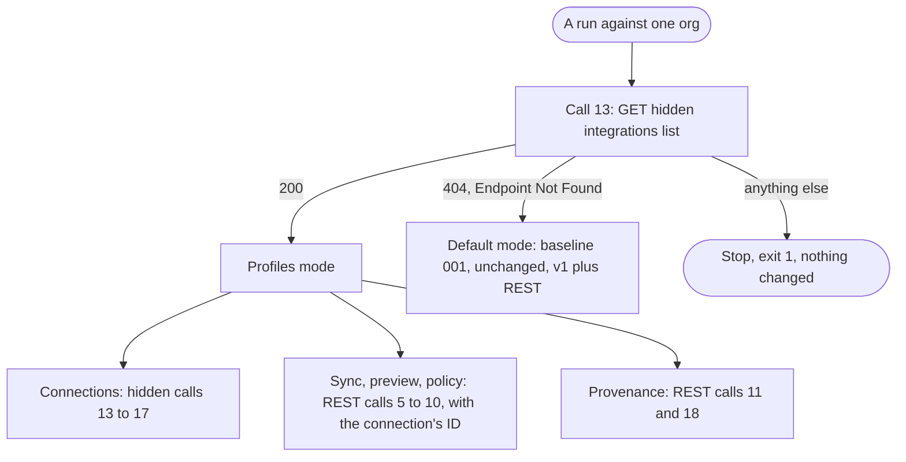
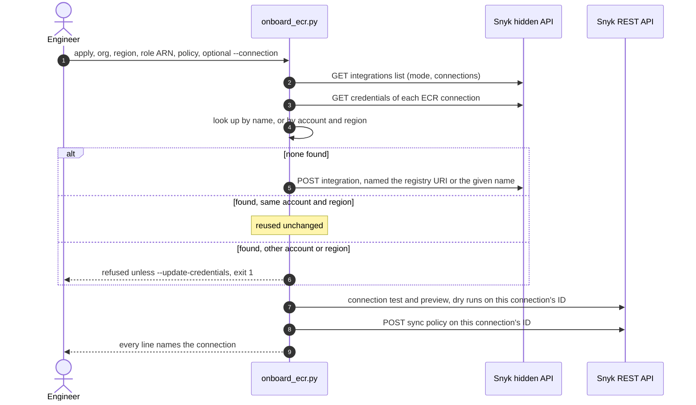
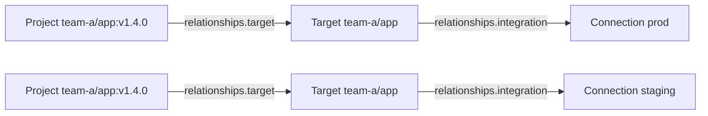
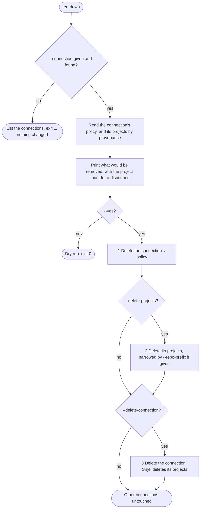

# Implementation Plan: Several ECR registries in one Snyk org

**Branch**: `002-multi-ecr-connections` | **Date**: 2026-11-24 | **Spec**: [spec.md](spec.md)

**Input**: Feature specification from `specs/002-multi-ecr-connections/spec.md`, clarified twice on
2026-11-24.

## Summary

Orgs where Snyk has turned on its multiple profiles feature hold any number of ECR connections, and
the tool must manage them one at a time without touching the others. The tool asks Snyk for the
org's mode on every run. In default mode it behaves exactly as baseline 001. In profiles mode it finds
the named connection, or the one that reads the run's ECR, through Snyk's unpublished integrations
API, and reuses the baseline's sync, preview, and policy calls with that connection's ID. Where an
image came from is read from Snyk's own record (project → target → connection), never from
repository names. On the AWS side the module already trusts orgs without regard to regions; the
example root gains one optional input so an account read only by profiles-mode orgs needs no region
keys.

## Owner decisions (2026-11-24)

1. **The one exception to the constitution is approved** (Principle IV), with its conditions: the
   profiles calls use Snyk's unpublished `hidden` integrations API. See
   [Complexity Tracking](#complexity-tracking). Open action: ask the beta team whether and when the
   API will be published.
2. **The Terraform input is `snyk_profile_orgs`**, beside the region-to-org map
   ([research R8](research.md#r8-account-access-without-regions-fr-016-fr-017-question-7)).
3. **The live test runs on `antonio-org` for now**, under the harness's guards, and moves to a
   throwaway org if the beta team enables one
   ([research R10](research.md#r10-where-the-profile-mode-live-test-runs)).

## Technical Context

**Language/Version**: Python 3, standard library only, as the baseline; HCL for Terraform 1.5 or later
(module) and the example root, whose minimum this feature does not raise.

**Primary Dependencies**: none new. Snyk's v1 API (default mode only), its REST API (both modes), and
its `hidden` integrations API at version `2024-10-15` (profiles mode only).

**Storage**: none of its own; see [data-model.md](data-model.md).

**Testing**: the baseline's `make check`, with `FakeClient` routes for calls 13 to 18 and new
`terraform test` runs; live, a new e2e step `profiles` beside the baseline's `single`.

**Target Platform**: as the baseline.

**Project Type**: CLI tool plus a Terraform module.

**Performance Goals**: not applicable. Profiles mode adds one read per connection (call 14) and a
paged targets list (call 18) to the reads of a run; default mode adds call 13.

**Constraints**: in profiles mode the v1 API is never called; every change acts on exactly one
connection; output in default mode is unchanged (FR-001), since the harness and operators parse it.

**Scale/Scope**: tens of connections per org at most; provenance reads every target of the org once
per run.

**Open before implementation**: the body of call 16 (live check L1), and four more live checks
([research](research.md#live-checks-before-or-during-implementation)). None blocks the design.

## Constitution Check

*GATE: Must pass before Phase 0 research. Re-check after Phase 1 design.* Checked against constitution
v2.0.0.

| Principle | Gate | Result | Evidence |
|-----------|------|--------|----------|
| I. Starting state never touched | Deletes limited, per connection, to its policy, the connection itself (profiles mode), and projects by Snyk's record, optionally narrowed by a prefix; a unit test in each mode | Pass | [data-model.md, refusal rules](data-model.md#validation-and-refusal-rules-before-any-write); the default-mode test stays, a profiles-mode test is added |
| II. Standard tooling | Terraform plus one standard-library script | Pass | No new dependency; the profiles code lives in `scripts/onboard_ecr.py` |
| III. Safe by default | `plan` and the teardown dry run cover every new write; `--delete-connection` needs `--yes`; re-runs reach the same connection | Pass | [contracts/cli.md](contracts/cli.md); SC-007 |
| IV. Snyk's terms and published contracts | Published request shapes only, or undocumented behavior marked and verified live | **Violation, justified** | Calls 13 to 17 use the unpublished `hidden` tier: [Complexity Tracking](#complexity-tracking) |
| V. Offline verification | `make check` green with no network or credentials | Pass by design | `FakeClient` covers calls 13 to 18; no test reaches Snyk or AWS |
| VI. Secrets stay out | Token only to `*.snyk.io`; no real IDs in the repository | Pass | The hidden tier is on the same API host; the research uses placeholder IDs |
| VII. Claim only what was verified | Verified, live, and unverified kept apart | Pass | [contracts/snyk-api.md](contracts/snyk-api.md) marks each call; call 16 is marked unverified |
| VIII. Spec is the contract | Spec, diagrams, and contracts before code | Pass | This plan and its contracts precede any code |
| Invariant: connections per org | Mode from Snyk, never guessed; one connection per change | Pass | [research R1](research.md#r1-mode-detection-fr-002-question-3), R3 |
| Invariant: provenance from Snyk | Never from repository names | Pass | [research R5](research.md#r5-provenance-fr-009-to-fr-011-fr-013) |
| Invariant: one role per account | Trust independent of regions | Pass | The module is unchanged; [research R8](research.md#r8-account-access-without-regions-fr-016-fr-017-question-7) |
| Invariant: least privilege | Unchanged | Pass | No change to the role's permissions |
| Invariant: API split by mode | v1 only in default mode; connections only through the integrations API in profiles mode; REST for the rest | Pass | [contracts/snyk-api.md](contracts/snyk-api.md#changed-calls) |

**Gate**: passes, with one violation justified below and approved by the owner on 2026-11-24.

**Post-design re-check**: unchanged after Phase 1.

## Architecture

### Which API a run uses



### `apply` in profiles mode



### Where an image came from



Two projects with the same name belong to different targets, and each target names the connection
that imported it. A target that names no listed connection makes its projects "connection unknown",
and project removal for that connection is refused.

### `teardown` in profiles mode



## Project Structure

### Documentation (this feature)

```text
specs/002-multi-ecr-connections/
├── spec.md               # What and why, clarified twice (/speckit-specify, /speckit-clarify)
├── research.md           # Findings from Snyk's UI and API, decisions R1 to R11, live checks L1 to L5
├── plan.md               # This file (/speckit-plan)
├── data-model.md         # Mode, connection, target, project, account access; lookup and refusal rules
├── quickstart.md         # Offline, default-mode, and profiles-mode validation
├── contracts/
│   ├── cli.md            # New options, changed meanings, output in profiles mode
│   ├── snyk-api.md       # Calls 13 to 18, and what changes for calls 1 to 12
│   └── terraform-module.md  # The example root's new input and output
└── checklists/
    └── requirements.md   # Spec quality checklist
```

### Source Code (repository root)

```text
scripts/onboard_ecr.py              # Mode check; hidden-API calls in one section of SnykClient;
                                    #   connection lookup; profiles paths of plan, apply, status, teardown
tests/test_onboard_ecr.py           # FakeClient routes for calls 13 to 18; profiles-mode tests,
                                    #   including the Principle I delete scope for that mode
examples/main.tf                    # snyk_profile_orgs, the trusted set, the trusted_org_ids output
examples/snyk_orgs.tftest.hcl       # New runs for the profile-orgs input
examples/sandbox/e2e.sh             # New step: profiles
examples/sandbox/harness.py         # Profiles-mode preflight; a v1 create for live check L2
tests/test_harness.py               # Guards of the new harness code
README.md, docs/USAGE.md, docs/TESTING.md   # Profiles mode; the beta warning in USAGE replaced
specs/001-ecr-onboarding-baseline/  # FR-016's pointer updated once 002 is delivered
```

**Structure Decision**: unchanged. Profiles mode stays in the one script (Principle II), with the
hidden calls kept together so they can be swapped for a published API in one place.

## Requirement Mapping

| FR | Design |
|----|--------|
| FR-001 | Default mode follows the baseline's code paths; call 13 adds no output |
| FR-002 | Call 13 before anything else ([R1](research.md#r1-mode-detection-fr-002-question-3)) |
| FR-003 | `--connection` and `--delete-connection` refused in default mode, before any write |
| FR-004 | Lookup lists every ECR connection, the pre-flag one included ([R3](research.md#r3-finding-a-connection-fr-004-fr-005-fr-006), [R6](research.md#r6-a-connection-made-before-the-flag-question-10)) |
| FR-005 | Default name from the role's account and the region; lookup by ECR without a name |
| FR-006 | Reuse or create; refusal on another account or region; `--update-credentials` via call 16 ([R4](research.md#r4-repointing-a-connection---update-credentials-question-2)) |
| FR-007 | Calls 5 to 10 with the named connection's ID only |
| FR-008 | The baseline's failure hints, plus the connection's name |
| FR-009 | `[<connection>]` prefix ([contracts/cli.md](contracts/cli.md#output-contract-in-profiles-mode)) |
| FR-010 | `status` groups by connection ([R5](research.md#r5-provenance-fr-009-to-fr-011-fr-013)) |
| FR-011 | Provenance only from targets; "connection unknown" otherwise |
| FR-012 | Teardown requires a found `--connection` |
| FR-013 | Project selection by provenance; refusal on unknown provenance |
| FR-014 | `--delete-connection` (call 17), explicit, with a counted dry run |
| FR-015 | Policy, projects, connection, in that order |
| FR-016 | The module's region-free `snyk_org_ids`; the example's `snyk_profile_orgs` ([R8](research.md#r8-account-access-without-regions-fr-016-fr-017-question-7)) |
| FR-017 | `snyk_orgs` keeps its validations; the five existing `terraform test` runs keep passing |

## Complexity Tracking

| Violation | Why Needed | Simpler Alternative Rejected Because |
|-----------|------------|-------------------------------------|
| Principle IV: calls 13 to 17 use Snyk's unpublished `hidden` integrations API (version `2024-10-15`), whose request shapes are in no published spec | It is the only API that lists, creates, repoints, and deletes profiles. The v1 API sees one ECR integration per org, which is the limitation this feature removes (baseline FR-016) | Waiting for a published API: no date was found in Snyk's material (2026-11-24). Snyk's UI: out of scope (owner) and not scriptable |

**Approved** by the owner on 2026-11-24. **Conditions attached to the exception**, taken from Principle IV's own clause for undocumented
behavior: the calls live together in one section of `SnykClient`; the docs and
[contracts/snyk-api.md](contracts/snyk-api.md) mark them as undocumented; each is verified live before
release, and call 16 is not shipped until live check L1 settles its body; the API version is pinned;
moving to a published API is a planned change through Spec Kit, not a silent one.
