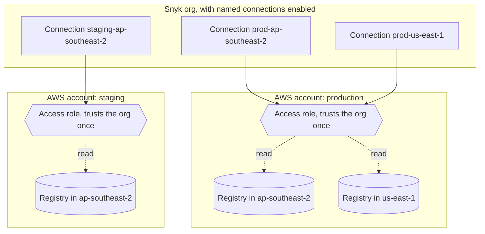

# Feature Specification: Several ECR connections in one Snyk org

**Feature Branch**: `002-multi-ecr-connections`

**Created**: 2026-11-24

**Status**: Draft, two clarifications open

**Input**: User description: "Support Snyk orgs that have the multiple ECR connections feature
enabled, so one org can hold several ECR connections. It is a feature flag; customers need to have
it enabled."

> **Relation to the baseline.** This feature changes the behavior specified in
> [001](../001-ecr-onboarding-baseline/spec.md). It replaces baseline FR-016 and extends FR-008,
> FR-011, FR-024, FR-025, FR-027, and FR-028 for orgs with the feature enabled. Everything else in
> 001 still holds, and for orgs without the feature nothing changes (FR-001 below).
>
> **Constitution impact.** It redefines the product invariant "One registry per Snyk org", so the
> constitution must be amended before `/speckit-plan` (Constitution, Product Invariants).

## Overview

Snyk can enable a feature for a customer that lets one Snyk org hold several ECR connections, each
with its own name. Without it, every registry (every region of every account) needs its own org,
which splits reporting and issue management across orgs; some enterprise customers will not onboard
to Snyk Container while that holds. With the feature on, the connections of one org can point at
registries in different regions and different AWS accounts.

Each connection has its own read proof, sync policy, and lifecycle (the 001 lifecycle diagram applies
per connection). The account's access role trusts the org once, however many of the account's
registries the org connects to, so connecting another region of an account the org already uses
needs no change in AWS.

## User Scenarios & Testing *(mandatory)*

### User Story 1 - Connect several registries to one org (Priority: P1)

An engineer whose org has the feature enabled connects registries from several regions and accounts
to that one org. Each becomes a named connection with its own read proof, preview, and sync policy.

**Why this priority**: it is the feature's purpose: one org for all of a customer's registries.

**Independent Test**: in a sandbox org with the feature enabled, connect two regions of one account
and one region of a second account. The org then has three named connections, and each imports only
the matching tags of its own registry.

**Acceptance Scenarios**:

1. **Given** an org with the feature and no ECR connection, **When** the engineer runs `apply` for a
   registry, **Then** the tool creates a named connection and continues as in baseline Story 1: read
   proof, preview, policy.
2. **Given** an org with connection A, **When** `apply` runs for another registry as connection B,
   **Then** B is created, and A's connection, policy, and projects are unchanged.
3. **Given** connection A exists, **When** `apply` runs again for A with another policy, **Then** A is
   reused and only A's policy is replaced.
4. **Given** no connection name is given, **When** `plan` or `apply` runs, **Then** the tool uses the
   default name derived from the registry's account and region, so a re-run reaches the same
   connection.

---

### User Story 2 - Grant access for several registries of one account (Priority: P1)

The engineer maps several regions of one AWS account to the same org, each as its own connection.
The account's role trusts the org once.

**Why this priority**: without it, Story 1 works only one registry per account.

**Independent Test**: map regions A and B of one account to org O with two connection names; the
access change is accepted and the role trusts O exactly once.

**Acceptance Scenarios**:

1. **Given** a mapping with regions A and B both mapped to org O under distinct connection names,
   **When** access is granted, **Then** the change is accepted and the role trusts O once.
2. **Given** a mapping that lists one org under two regions without connection names, **When** access
   is granted, **Then** it is rejected as in the baseline.
3. **Given** org O already trusted by the account's role, **When** a region is added for O, **Then**
   the role's trust does not change.

---

### User Story 3 - Pause or remove one connection (Priority: P2)

The engineer pauses, or removes, one connection of an org that has several. The other connections
keep working, and nothing they imported is touched.

**Why this priority**: shared orgs make a mistaken teardown more expensive, because one org now holds
the projects of many registries.

**Independent Test**: in an org with connections A and B, pause A, then remove A; B keeps its policy,
its projects, and a passing read proof throughout.

**Acceptance Scenarios**:

1. **Given** an org with several connections, **When** teardown runs without a connection name,
   **Then** nothing changes, and the tool lists the org's connections.
2. **Given** connections A and B, **When** teardown for A is confirmed with no options, **Then** only
   A's policy is removed.
3. **Given** connections A and B whose registries both hold a repository `team-a/app`, **When**
   teardown for A is confirmed with project removal under `team-a/`, **Then** no project imported
   through B is removed (see FR-011).
4. **Given** a request to remove connection A, **When** teardown is confirmed, **Then** A is handled
   as FR-012 states, and B is unchanged.

---

### User Story 4 - See every connection of an org (Priority: P2)

The engineer sees, in one report, every ECR connection of the org and its state.

**Why this priority**: with several connections, the first question is "which ones exist?"

**Independent Test**: `status` on an org with three connections lists all three.

**Acceptance Scenarios**:

1. **Given** an org with several connections, **When** `status` runs without a name, **Then** it lists
   every connection with its name, region, AWS account, and policy summary, and changes nothing.
2. **Given** a connection name, **When** `status` runs, **Then** it reports that connection as the
   baseline reports an org's single connection.

---

### Edge Cases

- **The feature is enabled but the org has only one connection**: it is still a named connection; a
  run without a name reaches it only if the default name matches (FR-003).
- **Two accounts, same region**: the default names differ because they include the account.
- **The same image exists in several accounts**: Snyk shows one project per connection; reducing those
  duplicates is out of scope.
- **A connection name that does not exist** given to `status` or `teardown`: the tool changes nothing
  and lists the org's connections.
- **The feature is turned off for an org that has several connections**: the behavior depends on
  what Snyk then does with the extra connections; planning decides it ([research](research.md), item 6).

## Requirements *(mandatory)*

### Functional Requirements

**Compatibility**

- **FR-001**: On orgs without the feature, every behavior of baseline 001 MUST stay unchanged: the same
  inputs, outputs, and exit codes.

**Connections**

- **FR-002**: On an org with the feature, each run of `plan` or `apply` MUST act on exactly one named
  connection, whose name is unique within the org.
- **FR-003**: When no name is given to `plan` or `apply`, the connection name MUST default to one built
  from the registry's AWS account and region (for example `ecr-111111111111-ap-southeast-2`). The
  engineer MAY give another name.
- **FR-004**: `apply` MUST create the named connection when it is missing, reuse it unchanged when it
  exists, and replace its stored role and region only when asked. It MUST NOT read or change any other
  connection's credentials, policy, or projects.
- **FR-005**: The read proof, the sync preview, and setting or replacing the policy MUST apply to the
  named connection only.
- **FR-006**: When a read proof fails after its retries, the explanation MUST name the connection as
  well as the org.
- **FR-007**: Every output line about a connection MUST identify it by name, so logs from runs on
  different connections can be told apart.

**Status**

- **FR-008**: `status` without a name MUST list every ECR connection of the org with its name, region,
  AWS account, and policy summary. With a name, it MUST report that connection as baseline FR-024
  reports an org's connection.

**Teardown**

- **FR-009**: On an org with more than one connection, `teardown` MUST require a connection name, and
  without one MUST change nothing and list the org's connections.
- **FR-010**: `teardown` MUST act only on the named connection: its policy, its credentials or the
  connection itself, and projects imported through it.
- **FR-011**: Removing projects MUST NOT remove a project imported through another connection, even
  when repository names are the same across accounts. When the tool cannot tell which connection
  imported a project, it MUST [NEEDS CLARIFICATION: refuse to remove projects in that org, remove
  them by prefix only when no other connection's registry has a repository under that prefix, or
  remove them by prefix with a warning?]
- **FR-012**: When asked to remove a named connection, `teardown` MUST [NEEDS CLARIFICATION: delete the
  connection entirely, remove only its credentials as the baseline does, or delete it entirely only
  when its projects were removed in the same run?]

**Access**

- **FR-013**: An account's access role MUST trust each org once, however many of the account's
  registries connect to that org.
- **FR-014**: The account's mapping MUST accept one org under several regions only when each of those
  entries names a distinct connection. Without connection names, it MUST reject one org under two
  regions, as baseline FR-008 does.
- **FR-015**: Connecting another registry of an account to an org the account's role already trusts
  MUST NOT change the role's trust. Adding a new org MUST change it in place, as baseline FR-009
  states.

### Key Entities

Changes to the baseline's entities:

- **Snyk org**: holds one or more ECR connections when Snyk has enabled the feature for it; otherwise
  at most one, as before.
- **ECR connection**: gains a **name**, unique within the org. It stores one role and one region, as
  before, and may belong to an org shared with registries of other accounts.
- **Region-to-org mapping entry**: may carry a **connection name**. Several entries of one account may
  name the same org only with distinct connection names.
- **Project**: imported through one connection. Whether Snyk records which one is a planning
  question (FR-011).

## Success Criteria *(mandatory)*

### Measurable Outcomes

- **SC-001**: An engineer connects at least three registries, across at least two AWS accounts, to one
  org with one `apply` each, and each shows as its own named connection with its own policy.
- **SC-002**: Acting on one connection changes zero items belonging to the org's other connections.
- **SC-003**: On orgs without the feature, every acceptance scenario of baseline 001 still passes
  unchanged.
- **SC-004**: One `status` run shows every connection of the org.
- **SC-005**: Connecting another region of an account to an org the account already trusts needs no
  change in AWS.
- **SC-006**: A teardown that names no connection, on an org with several, changes nothing in every
  case.

## Assumptions

- **Snyk enables the feature per customer.** It is a closed beta for ECR only, offered to Enterprise
  customers; engineers cannot turn it on themselves.
- **For orgs with the feature, connections are managed through Snyk's API.** Snyk's enablement
  material says the UI's registry configuration is removed for these orgs, with UI support planned for
  June 2026; whether it has shipped is unconfirmed. That makes a tool like this one the main way to
  manage these connections.
- **Each connection presents the org ID as the external ID**, as single connections do. To be
  confirmed in planning.
- **Out of scope**: consolidating existing one-org-per-registry setups into a shared org (moving
  projects between orgs), and reducing duplicate projects when one image exists in several accounts.
- **Default names** follow FR-003. They are stable because the role ARN carries the account, and the
  region is an input.
- **Connection names** follow Snyk's limits for profile names, to be confirmed in planning.
