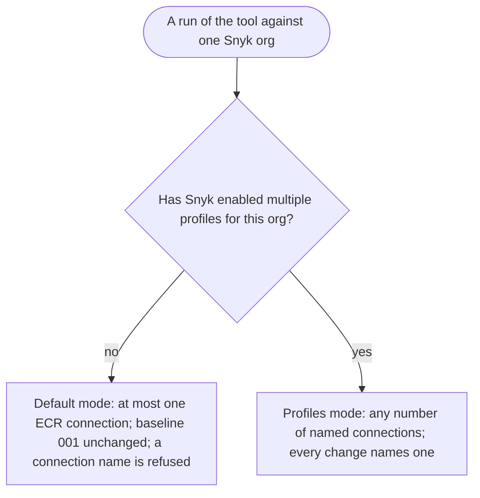
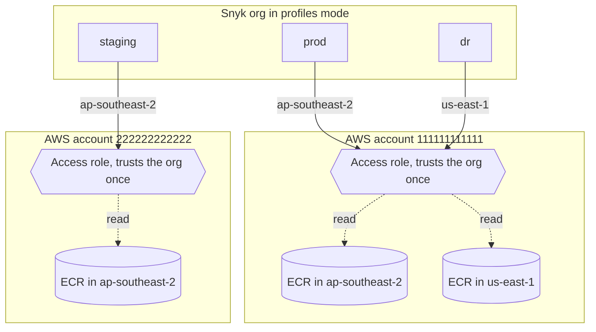
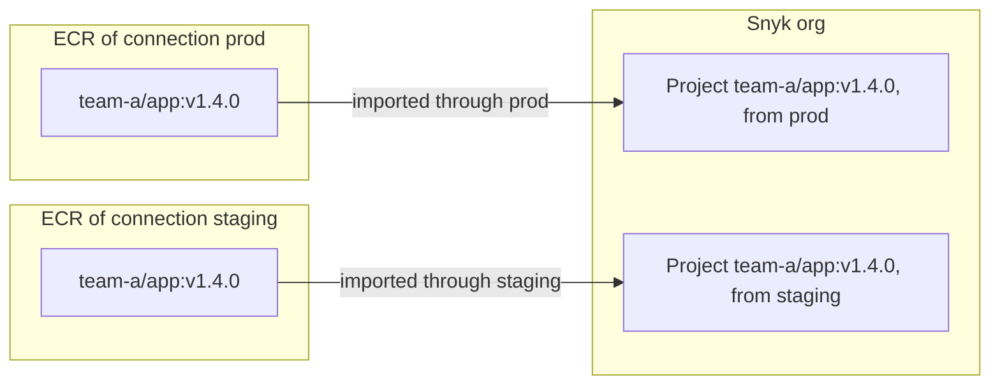

# Feature Specification: Several ECR registries in one Snyk org

**Feature Branch**: `002-multi-ecr-connections`

**Created**: 2026-11-24

**Status**: Draft, clarified 2026-11-24

**Input**: User description: "Support Snyk orgs that have the multiple ECR connections feature
enabled, so one org can hold several ECR connections. It is a feature flag; customers need to have
it enabled." Clarified: "The requirement is to be able to add multiple ECRs to the same org. The
region is independent (orthogonal) to it. A customer might operate one ECR for every environment, so
repositories overlap, and it should be clear where a vulnerable image was picked up. Removing a
connection deletes it, which is the same as disconnecting, and leaves the scans as history. The tool
works in the default behavior (one ECR per org) and, when the flag is enabled, in the new behavior
(many ECRs per org, managed as profiles)." Then: "We could have a default [name] obtained from the
ECR URI. As long as we're using the API to onboard, Snyk UI takes care of itself."

> **Relation to the baseline.** For orgs without the feature nothing changes: baseline
> [001](../001-ecr-onboarding-baseline/spec.md) applies as written (FR-001 below). For orgs with the
> feature, this spec replaces baseline FR-016 and extends FR-008, FR-011, FR-024, FR-025, FR-026,
> FR-027, and FR-028.
>
> **Constitution impact.** It changes Principle I (what may be deleted) and the product invariants on
> connections per org, role trust, and the API split: constitution v2.0.0.

## Overview

The tool runs in one of two modes, decided by whether Snyk has enabled its multiple-profiles feature
for the org. The engineer does not choose the mode; the org's setting does.

In profiles mode an org holds any number of ECR connections. Each one is a **named connection**
(Snyk calls it a profile) to one ECR registry, which is one AWS account and one region. Any mix is
allowed: several accounts in the same region, several regions of the same account, or both. The
region is an attribute of a connection and constrains nothing else. Each connection's name is unique
in the org. By default it is the registry's URI, such as
`111111111111.dkr.ecr.ap-southeast-2.amazonaws.com`, which says exactly where an image came from; the
engineer may choose another, such as the environment (`prod`, `staging`), as in the diagram.

**Where an image came from.** When environments share repository names, the same image appears in
several registries. Each copy becomes its own project in Snyk, and the tool always says which
connection imported it. It never infers that from the repository name.

Each connection follows the baseline's lifecycle on its own, with one difference: disconnecting
deletes the connection, and Snyk then deletes its projects, as its own UI does. Pausing is the way to
keep a connection's results.

## Clarifications

### Session 2026-11-24

Earlier answers from this day are folded into the Input above and recorded in
[research](research.md), "Decisions from clarification".

- Q: An org already has an ECR connection, made by the baseline or in Snyk's UI, when Snyk enables
  the feature. What does the tool do with it? → A: It is one of the org's named connections, under the
  name Snyk gives it, and every operation works on it like any other. A run without a name for that
  same ECR reaches it instead of creating a duplicate.
- Q: `apply` names an existing connection but gives a different AWS account or region than the
  connection stores. What happens? → A: Nothing changes. The tool says which ECR the connection points
  at, and repointing it needs an explicit request.

## User Scenarios & Testing *(mandatory)*

### User Story 1 - Connect several ECRs to one org (Priority: P1)

An engineer whose org has the feature connects one ECR per environment to that one org, whatever
their accounts and regions. Each becomes a named connection with its own read proof, preview, and
sync policy.

**Why this priority**: it is the feature: one org for all of a customer's registries, so reporting and
issue management are not split across orgs.

**Independent Test**: in a sandbox org with the feature, connect `prod` and `staging`, two ECRs in the
same region of different accounts, and `dr`, a second region of the first account. The org then has
three connections, and each imports only the matching tags of its own ECR.

**Acceptance Scenarios**:

1. **Given** an org with the feature and no connection, **When** the engineer runs `apply` naming
   `prod`, **Then** the tool creates `prod` and continues as in baseline Story 1: read proof, preview,
   policy.
2. **Given** an org with `prod`, **When** `apply` runs naming `staging` for another ECR, in any account
   and any region, **Then** `staging` is created, and `prod`'s connection, policy, and projects are
   unchanged.
3. **Given** `prod` exists, **When** `apply` runs again for `prod` with another policy, **Then** `prod`
   is reused and only its policy is replaced.
4. **Given** an org with the feature, **When** `plan` or `apply` runs without a connection name,
   **Then** the connection is named after its registry's URI, so a re-run for the same ECR reaches the
   same connection.
5. **Given** an org without the feature, **When** a run names a connection, **Then** nothing changes,
   and the tool says the org is in default mode.
6. **Given** an org whose connection existed before Snyk enabled the feature, **When** `plan` or
   `apply` runs for that connection's ECR without a name, **Then** the existing connection is used,
   under the name Snyk gives it, and no second connection is created.
7. **Given** `prod` points at one ECR, **When** `apply` names `prod` with another AWS account or region,
   **Then** nothing changes, the tool names the ECR `prod` points at, and repointing `prod` needs an
   explicit request.

---

### User Story 2 - Know which ECR an image came from (Priority: P1)

An engineer looking at a vulnerable image in a shared org needs to know which ECR, and so which
environment, it was picked up from, even when the same repository exists in several.

**Why this priority**: environments overlap in repository names by design, and Snyk's own project page
shows only that a project came from ECR, not which connection. Without this, a shared org makes
triage and cleanup unsafe.

**Independent Test**: connect `prod` and `staging`, whose ECRs both hold `team-a/app:v1.4.0`. `status`
shows two projects for that image, one under each connection.

**Acceptance Scenarios**:

1. **Given** the same repository and tag in two connected ECRs, **When** `status` runs, **Then** each
   project appears under the connection that imported it.
2. **Given** a run of `plan` or `apply`, **When** the read proof and the preview list repositories and
   tags, **Then** every line names the connection.
3. **Given** Snyk does not record which connection imported a project, **When** the tool reports it,
   **Then** it says so rather than guessing from the repository name.

---

### User Story 3 - Pause or disconnect one connection (Priority: P2)

The engineer pauses or disconnects one connection of a shared org. The other connections keep
working, and nothing they imported is touched. Disconnecting deletes the connection and, as in Snyk's
own UI, its projects; pausing keeps both.

**Why this priority**: in a shared org a mistaken teardown reaches more projects, so it must be scoped
by connection.

**Independent Test**: in an org with `prod` and `staging`, pause `staging`, then disconnect it. `prod`
keeps its policy, its projects, and a passing read proof throughout.

**Acceptance Scenarios**:

1. **Given** an org with the feature, **When** teardown runs without a connection name, **Then**
   nothing changes, and the tool lists the org's connections.
2. **Given** `prod` and `staging`, **When** teardown for `staging` is confirmed with no options,
   **Then** only `staging`'s policy is removed (a pause).
3. **Given** a request to disconnect `staging`, **When** teardown runs unconfirmed, **Then** nothing
   changes, and the tool says that `staging` and the projects imported through it will be deleted.
4. **Given** the same request, **When** teardown is confirmed, **Then** the `staging` connection is
   deleted, Snyk removes the projects imported through it, and `prod` is unchanged.
5. **Given** a request to remove some of `staging`'s projects while keeping the connection, **When**
   teardown is confirmed, **Then** only projects imported through `staging` are removed, optionally
   narrowed by a repository prefix, even where `prod` has the same repositories.
6. **Given** Snyk does not record which connection imported the projects, **When** that removal is
   requested, **Then** the tool refuses it and changes nothing.

---

### User Story 4 - Grant access without regard to region (Priority: P2)

The engineer grants each AWS account's access role trust for the orgs that read its ECRs. Regions
play no part in that trust.

**Why this priority**: it keeps AWS changes rare. Connecting another ECR for an org an account
already trusts needs nothing in AWS.

**Independent Test**: with the role of account 111111111111 trusting org O, connect a second ECR of
that account (any region) to O. No AWS change is needed or made.

**Acceptance Scenarios**:

1. **Given** an account whose role already trusts org O, **When** another of its ECRs is connected to
   O, **Then** the role's trust does not change.
2. **Given** an org not yet trusted by an account, **When** it is added, **Then** the trust changes in
   place, as in the baseline.
3. **Given** an org in default mode, **When** access is granted with the baseline's region-to-org
   mapping, **Then** it behaves exactly as the baseline specifies.

---

### User Story 5 - See every connection of an org (Priority: P3)

The engineer sees, in one read-only report, every connection of the org and its state.

**Why this priority**: useful once there are several, but nothing else depends on it.

**Independent Test**: `status` on an org with three connections lists all three and changes nothing.

**Acceptance Scenarios**:

1. **Given** an org with the feature, **When** `status` runs without a name, **Then** it lists every
   connection with its name, AWS account, region, and policy summary.
2. **Given** a connection name, **When** `status` runs, **Then** it reports that connection as the
   baseline reports an org's single connection.

---

### Edge Cases

- **A name that does not exist**, given to `status` or `teardown`: nothing changes, and the tool lists
  the org's connections.
- **Right after a disconnect**, `status` may still list the connection's projects while Snyk removes
  them; the tool says their removal is in progress rather than reporting them as kept.
- **A name already used in the org**, given to `apply` with a different AWS account or region than the
  connection stores: nothing changes. The tool says which ECR the connection points at, and replacing
  its role and region needs an explicit request.
- **A connection made before Snyk enabled the feature**: it is one of the org's named connections,
  under the name Snyk gives it, and every operation works on it as on any other.
- **Exactly one connection in profiles mode**: it still has a name, and changes still require it.
- **Two connections to the same ECR**: a run without a name reaches the existing connection to that
  ECR, whatever its name, so no duplicate is made. Only an explicit new name creates a second
  connection to one ECR; the tool allows it, warns that the same images will then be imported twice,
  and changes nothing else. Once two connections point at one ECR, a run without a name changes
  nothing and lists both.
- **Snyk turns the feature off for an org with several connections**: depends on what Snyk does with
  the extra connections; decided in planning ([research](research.md), item 6).

## Requirements *(mandatory)*

### Functional Requirements

**Modes**

- **FR-001**: For an org without the feature (default mode), every behavior of baseline 001 MUST stay
  unchanged: the same inputs, outputs, and exit codes.
- **FR-002**: Profiles mode MUST apply exactly when Snyk has enabled the feature for the org. The tool
  MUST determine the org's mode before it changes anything, and MUST NOT apply default-mode behavior
  to an org in profiles mode.
- **FR-003**: A connection name given for an org in default mode MUST be refused before any change.

**Connections (profiles mode)**

- **FR-004**: An org MAY hold any number of connections, to ECRs in any AWS accounts and any regions.
  No connection's account or region MAY constrain another's. A connection made before Snyk enabled
  the feature MUST count as one of them, under the name Snyk gives it.
- **FR-005**: Every operation except `status` MUST act on exactly one connection, identified by a name
  unique within the org. For `plan` and `apply`, the name MUST default to the connection's ECR registry
  URI (`<account>.dkr.ecr.<region>.amazonaws.com`, or `.amazonaws.com.cn` in China regions); the
  engineer MAY give another. Without a name, a run MUST reach the existing connection to that ECR,
  whatever its name, and MUST create one under the default name only when none exists; where several
  connections point at that ECR, it MUST change nothing and list them. `teardown` MUST be given the
  name, and without one MUST change nothing and list the org's connections.
- **FR-006**: `apply` MUST create the named connection when it is missing, reuse it unchanged when it
  exists, and replace its stored role and region only when asked. When the run gives a different AWS
  account or region than the named connection stores, `apply` MUST change nothing unless asked, and
  MUST say which ECR the connection points at. It MUST NOT read or change any other connection's
  credentials, policy, or projects.
- **FR-007**: The read proof, the sync preview, and setting or replacing the policy MUST apply to the
  named connection only.
- **FR-008**: When a read proof fails after its retries, the explanation MUST name the connection as
  well as the org.

**Provenance (profiles mode)**

- **FR-009**: Every line the tool prints about a repository, an image, or a project MUST name the
  connection it belongs to.
- **FR-010**: `status` MUST list every connection (name, AWS account, region, policy summary) and the
  projects imported through each. The same repository imported through two connections MUST appear
  under each of them.
- **FR-011**: The tool MUST take a project's connection from Snyk's own record of which connection
  imported it, never from repository names. Where Snyk provides no such record, the tool MUST say so
  and MUST NOT guess.

**Teardown (profiles mode)**

- **FR-012**: `teardown` MUST act only on the named connection.
- **FR-013**: Removing projects MUST select the projects imported through the named connection; a
  repository prefix MAY narrow that selection. Where Snyk does not record which connection imported
  them, removal MUST be refused with nothing changed.
- **FR-014**: Disconnecting a named connection MUST delete it, as Snyk's own UI does, and Snyk then
  deletes every project imported through it. Disconnecting MUST be requested explicitly, apart from a
  pause, and confirmed. The dry run MUST say that the connection's projects will be deleted, and how
  many where Snyk's record allows counting them. To keep a connection's results, the engineer pauses
  it instead.
- **FR-015**: A confirmed teardown MUST remove the connection's policy first, then the requested
  projects, then, when asked, the connection.

**Access**

- **FR-016**: An account's access MUST be stated as the set of orgs that read its ECRs, independent of
  regions. Connecting another ECR for an org the account already trusts MUST NOT change anything in
  AWS; adding an org MUST change the trust in place.
- **FR-017**: For orgs in default mode, the baseline's region-to-org mapping and its validations
  (baseline FR-008) MUST keep working unchanged.

### Key Entities

Changes to the baseline's entities:

- **Mode**: per org, decided by Snyk's feature setting: default (at most one ECR connection) or
  profiles (any number of named connections).
- **Named connection** (profiles mode): a link from an org to one ECR, with a name unique in the org,
  and the role and region it stores. Deleting it disconnects the ECR. A connection made before Snyk
  enabled the feature is one too, under the name Snyk gives it.
- **Project**: in profiles mode, imported through exactly one named connection, which the tool reports
  from Snyk's record.
- **Account access**: the set of orgs an account's role trusts, independent of regions and of how many
  connections each org has to the account.

## Success Criteria *(mandatory)*

### Measurable Outcomes

- **SC-001**: One org holds at least three connections, including two in the same region of different
  accounts and two in different regions of the same account, each added with one `apply`.
- **SC-002**: Acting on one connection changes zero items belonging to the org's other connections.
- **SC-003**: For every project in a profiles-mode org, the tool names the connection it came from,
  and attributes zero projects by repository name.
- **SC-004**: For default-mode orgs, every acceptance scenario of baseline 001 still passes unchanged.
- **SC-005**: Connecting another ECR for an org the account already trusts needs zero AWS changes.
- **SC-006**: A teardown that names no connection on a profiles-mode org, and any run that names a
  connection on a default-mode org, change nothing in every case.
- **SC-007**: Re-running `apply` for the same ECR without a name reaches the same connection every time,
  including a connection made before Snyk enabled the feature.

## Assumptions

- **Snyk enables the feature per customer.** It is a closed beta, for ECR, offered to Enterprise
  customers; engineers cannot turn it on themselves.
- **Snyk's API shows the org's mode.** Its list of connections answers for an org with the feature and
  refuses an org without it, whatever connections the org holds. Verified live on 2026-11-24 on one org
  of each kind ([research](research.md), question 3).
- **The tool manages connections in profiles mode through Snyk's API.** Snyk's UI also offers "Create
  new ECR profile" with the same fields (name, region, role ARN), observed on 2026-11-24, so
  connections made either way are the same kind of object.
- **Snyk records which connection imported each project, and exposes it**: each project belongs to a
  target, and the target names its connection. Verified live on 2026-11-24
  ([research](research.md), item 1). The refusal paths in FR-011 and FR-013 remain as a safeguard for
  any project without that record.
- **Snyk's UI is out of scope** (owner, 2026-11-24). The tool onboards through Snyk's API, and how
  Snyk's UI then presents connections and projects is Snyk's concern. The tool shows provenance in its
  own output.
- **Each connection presents the org ID as the external ID**, as a single connection does. Verified
  live on 2026-11-24.
- **Deleting a connection deletes its projects**, as Snyk's UI says ("permanently delete all projects
  associated with this profile"). Verified live through the API on 2026-11-24: the test project was
  gone seconds after the delete, although the UI describes the removal as scheduled. The tool follows
  the product (owner, 2026-11-24).
- **A connection made before the feature works as a profile.** Snyk lists older integrations of other
  types as "Default profile"; how it names and exposes an older ECR connection is confirmed in planning
  ([research](research.md), item 10).
- **Out of scope**: consolidating existing one-org-per-registry setups into a shared org, and reducing
  duplicate projects when one image exists in several ECRs.
- **Names** must fit Snyk's limits for profile names. The registry URI is at most about 60 characters
  of letters, digits, dots, and hyphens. Snyk accepted it as is on 2026-11-24
  ([research](research.md), question 8).
- **The registry is in the role's account**, as Snyk's setup prescribes, so the default name follows
  from the role and the region the engineer already gives.
